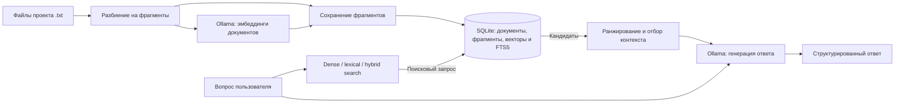
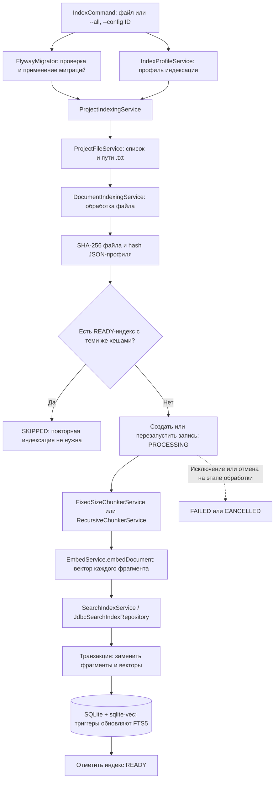
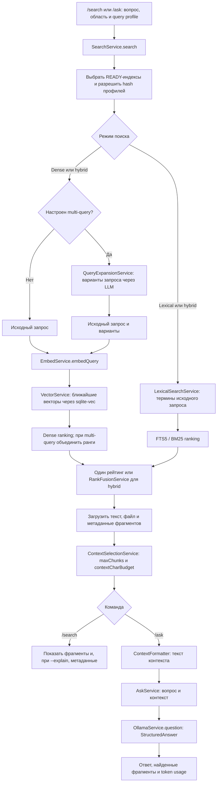
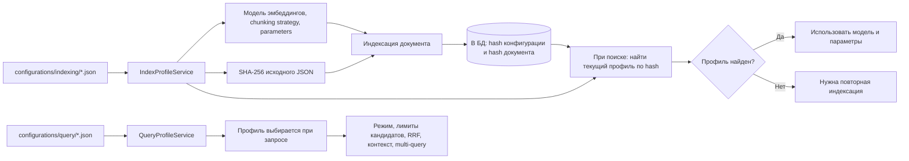
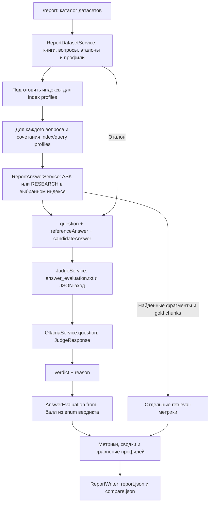
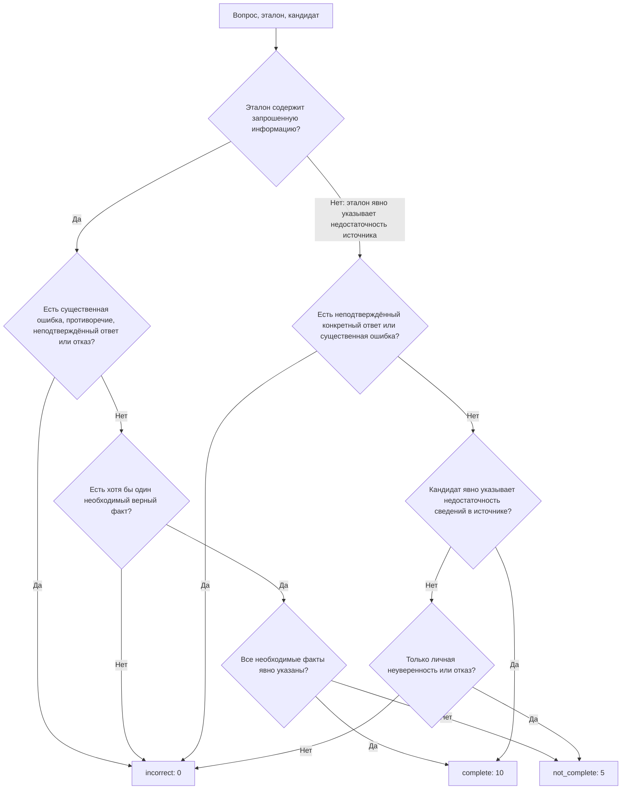
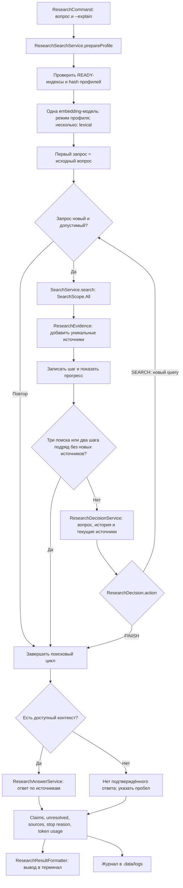
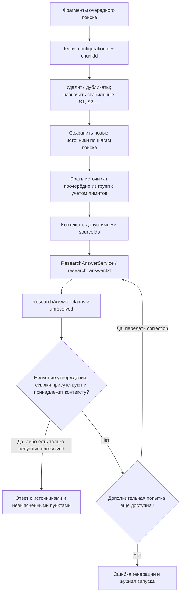

# Архитектура university-cli

Схемы отражают текущую реализацию приложения: индексацию `.txt`, обычный RAG, оценку ответов и агентный поиск. Названия классов совпадают с кодом. `Ollama` обозначает локальный HTTP-сервис моделей, а `SQLite` — общую базу документов, индексов и фрагментов.

## 1. Общая идея

Приложение сначала подготавливает поисковые индексы. Затем вопрос преобразуется в поисковый запрос, из базы извлекаются фрагменты, и модель получает их вместе с вопросом для генерации структурированного ответа.

В базе работают два поисковых механизма: векторы через `sqlite-vec` и полнотекстовый индекс FTS5. Hybrid-поиск объединяет их ранги через RRF. Эмбеддинги документов и запросов проходят через `EmbedService`.

Основные команды:

| Команда | Назначение |
| --- | --- |
| `/index` | Создать или обновить индексы документов. |
| `/search` | Получить найденные фрагменты без генерации ответа. |
| `/ask` | Выполнить один поисковый проход и сформировать ответ. |
| `/report` | Сравнить профили на датасетах и оценить ответы через Judge. |
| `/research` | Выполнить до трёх адаптивных поисков и сформировать ответ с источниками. |

В одноразовом запуске префикс `/` необязателен. CLI и интерактивный режим используют общие команды и сервисы.

Границы модулей:

| Модуль | Ответственность |
| --- | --- |
| `core` | Общие модели, ресурсы, отмена операций и журналы. |
| `storage-sqlite` | JDBC, Flyway, SQLite, загрузка sqlite-vec. |
| `llm-ollama` | HTTP/JSON-взаимодействие с Ollama, эмбеддинги и JSON Schema. |
| `rag` | Индексация, поиск, сборка контекста, обычный и агентный ответ. |
| `evaluation` | Датасеты, Judge, метрики, сравнение профилей и отчёты. |
| `cli` | Команды, аргументы, Koin, статусы и терминальный интерфейс. |

## 2. Детализация индексации, вопросов и профилей

### 2.1. Индексация документов

`DocumentIndexingService` выбирает алгоритм разбиения по профилю. `SearchIndexService` проверяет соответствие фрагментов и векторов; JDBC-репозиторий выполняет запись в транзакции. FTS5 обновляется триггерами при изменении таблицы фрагментов.

При обработке нескольких файлов `ProjectIndexingService` собирает результаты `INDEXED`, `SKIPPED` и ошибки отдельных файлов. Проверки отмены находятся в циклах индексации и вычисления эмбеддингов.

Код: [ProjectIndexingService](../../../rag/src/main/kotlin/university/cli/service/indexing/ProjectIndexingService.kt), [DocumentIndexingService](../../../rag/src/main/kotlin/university/cli/service/indexing/DocumentIndexingService.kt), [JdbcSearchIndexRepository](../../../storage-sqlite/src/main/kotlin/university/cli/repository/JdbcSearchIndexRepository.kt).

### 2.2. Вопрос и поиск контекста

Область обычного поиска — все готовые индексы, один файл или один индекс. Для dense/hybrid выбранные индексы должны использовать одну модель эмбеддингов. Лексический поиск не требует общего пространства векторов.

Multi-query расширяет исходный запрос перед поиском. Лексическая ветка использует исходный запрос; варианты применяются в dense-ветке. Это отличается от `/research`, где следующий запрос выбирается после чтения результатов предыдущего поиска.

`ContextSelectionService` ограничивает количество фрагментов и длину отформатированного контекста в символах. Если контекст пуст, `/ask` сообщает об отсутствии найденных фрагментов и не запускает генерацию ответа.

Код: [SearchService](../../../rag/src/main/kotlin/university/cli/service/retrieval/SearchService.kt), [QueryExpansionService](../../../rag/src/main/kotlin/university/cli/service/retrieval/QueryExpansionService.kt), [ContextSelectionService](../../../rag/src/main/kotlin/university/cli/service/retrieval/ContextSelectionService.kt), [AskService](../../../rag/src/main/kotlin/university/cli/service/retrieval/AskService.kt).

### 2.3. Профили и их жизненный цикл

| Профиль | Что задаёт | Когда применяется |
| --- | --- | --- |
| Index profile | Модель эмбеддингов, стратегию и параметры разбиения. | При создании индекса и разрешении его конфигурации во время поиска. |
| Query profile | Dense/lexical/hybrid, лимиты кандидатов, RRF, бюджет контекста, multi-query. | При каждом поисковом запросе. |

В базе хранится хеш JSON-профиля индексации. Изменение файла, включая форматирование, меняет хеш: старый индекс больше не соответствует текущему ресурсу. Query profile не закреплён за индексом и выбирается отдельно.

Код и ресурсы: [IndexProfileService](../../../rag/src/main/kotlin/university/cli/service/configuration/IndexProfileService.kt), [QueryProfileService](../../../rag/src/main/kotlin/university/cli/service/configuration/QueryProfileService.kt), [index profiles](../../../core/src/main/resources/configurations/indexing), [query profiles](../../../core/src/main/resources/configurations/query).

## 3. Детализация JudgeService

### 3.1. Как ответ попадает на оценку

Judge вызывается в `/report`. Датасет содержит вопросы и эталонные ответы; `ReportAnswerService` выбирает `AskService` или `ResearchService` по полю `answerMode` и передаёт результат в оценку. По умолчанию используется `ASK`; `RESEARCH` включает агентный цикл в пределах индекса книги. В самостоятельных `/ask` и `/research` автоматического вызова Judge нет.

Judge получает вопрос, эталонный ответ и ответ-кандидат. Он не получает весь корпус, набор найденных фрагментов или `gold chunks`. Корректность ответа и качество извлечения фрагментов оцениваются разными механизмами.

`OllamaService` формирует JSON Schema по сериализуемому `JudgeResponse` и декодирует результат. Для судьи используется `OllamaConfig.questionModel`. Модель возвращает только вердикт и объяснение; балл выбирается программно:

| Вердикт | Балл | Смысл |
| --- | --- | --- |
| `complete` | 10 | Все необходимые факты явно присутствуют, существенных ошибок нет. |
| `not_complete` | 5 | Часть необходимых фактов верна, другая отсутствует или неоднозначна; существенных ошибок нет. |
| `incorrect` | 0 | Существенная ошибка, противоречие либо отсутствие требуемых верных фактов. |

Ошибка вызова модели или декодирования записывается как ошибка Judge в отчёте. Она не превращается автоматически в вердикт `incorrect`. Отмена операции передаётся выше.

Код: [JudgeService](../../../evaluation/src/main/kotlin/university/cli/service/evaluation/JudgeService.kt), [AnswerEvaluation](../../../evaluation/src/main/kotlin/university/cli/model/AnswerEvaluation.kt), [ReportService](../../../evaluation/src/main/kotlin/university/cli/service/evaluation/ReportService.kt), [ReportMetricsService](../../../evaluation/src/main/kotlin/university/cli/service/evaluation/ReportMetricsService.kt), [промпт оценки](../../../core/src/main/resources/prompts/answer_evaluation.txt).

### 3.2. Логика вердикта в промпте

Это инструкция для LLM, а не Kotlin-алгоритм семантической проверки. Код обеспечивает формат ответа и соответствие балла вердикту. Промпт допускает эквивалентные формулировки, отличает пропуск от противоречия и даёт существенной ошибке приоритет над правильными частями ответа.

## 4. Детализация агентного подхода

### 4.1. Цикл /research

Команда `/research <question> [--explain]` использует все READY-индексы и default query profile. Первый поиск выполняется по исходному вопросу. После его результатов модель решает, нужен ли новый поиск и каким должен быть запрос.

Ошибочный пустой или слишком длинный запрос модели завершает запуск с ошибкой. Нормализованный повтор запроса останавливает поиск и позволяет сформировать ответ по уже собранным данным.

| Ограничение | Текущее значение |
| --- | --- |
| Вопрос и отдельный поисковый запрос | До 1 000 символов. |
| Поисковые проходы | До 3. |
| Остановка без прогресса | 2 последовательных поиска без новых источников. |
| Один поисковый контекст | До 8 фрагментов в пределах 5 500 символов. |
| Общий контекст источников для модели | До 12 источников в пределах 12 000 символов сериализованного JSON. |
| Multi-query внутри `/research` | Отключён. |
| Повторная генерация при неверных ссылках или структуре ответа | Одна дополнительная попытка после успешного декодирования JSON. |

Профиль копируется в памяти с ограничениями research; ресурсные JSON-файлы не изменяются. При разных моделях эмбеддингов приложение сообщает о переключении на lexical. Устаревшие хеши профилей требуют переиндексации.

Код: [ResearchCommand](../../../cli/src/main/kotlin/university/cli/command/ResearchCommand.kt), [ResearchService](../../../rag/src/main/kotlin/university/cli/service/research/ResearchService.kt), [ResearchSearchService](../../../rag/src/main/kotlin/university/cli/service/research/ResearchSearchService.kt), [ResearchDecisionService](../../../rag/src/main/kotlin/university/cli/service/research/ResearchDecisionService.kt).

### 4.2. Накопление доказательств и проверка ответа

`ResearchEvidence` сохраняет все найденные уникальные источники, но передаёт модели ограниченную выборку. Поочерёдный отбор из групп разных шагов помогает сохранить сведения, полученные на поздних поисках. Принадлежность источника задаётся парой ID индекса и фрагмента, поэтому одинаковый `chunkId` в разных индексах не создаёт коллизию.

Каждое утверждение содержит текст и список `sourceIds`. Код проверяет непустоту текста, наличие ссылок, принадлежность ссылок переданному контексту и непустоту пунктов `unresolved`. Эта проверка не устанавливает, подтверждает ли цитируемый текст утверждение по смыслу: смысловую привязку задаёт промпт модели.

Ошибка HTTP или декодирования JSON завершает запуск с ошибкой; дополнительная попытка относится к проверке уже декодированного `ResearchAnswer`. При отсутствии доступного контекста ответ с невыясненным пунктом формируется без вызова финальной модели.

`FINISH` означает решение модели закончить поиск. Достижение лимита, повтор запроса или отсутствие новых источников также останавливают цикл. Ни одна из этих причин сама по себе не доказывает полноту ответа или отсутствие информации во всём корпусе.

В журнал записываются решения модели с ID доступного им контекста, поисковые шаги, найденные источники, финальный набор источников, token usage, ответ и статус запуска. Запись журнала предусмотрена также при ошибках и отмене. `--explain` показывает запросы и число новых источников; строка статуса показывает текущую стадию. Отмена интерактивной операции проходит через `OperationCancellationService`.

Judge не участвует в выборе поисковых действий агента. В `/report` датасет с `answerMode: RESEARCH` запускает агентный цикл в индексе текущей книги и затем оценивает финальный ответ судьёй. Отчёт сохраняет `research` с траекторией и `evidenceRecall` по финальному контексту; ранговые метрики для этого контекста отключены. Датасеты без этого поля продолжают запускать `AskService`.

Код и ресурсы: [ResearchEvidence](../../../rag/src/main/kotlin/university/cli/service/research/ResearchEvidence.kt), [ResearchAnswerService](../../../rag/src/main/kotlin/university/cli/service/research/ResearchAnswerService.kt), [модели research](../../../core/src/main/kotlin/university/cli/model/ResearchResult.kt), [ResearchResultFormatter](../../../cli/src/main/kotlin/university/cli/util/ResearchResultFormatter.kt), [промпт решения](../../../core/src/main/resources/prompts/research_decision.txt), [промпт ответа](../../../core/src/main/resources/prompts/research_answer.txt).
