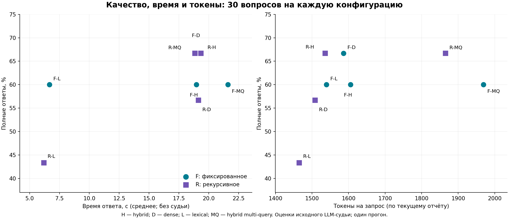

# Исследование RAG: фиксированное разбиение, качество, время и токенный бюджет

Анализ выполнен 27 октября 2026 года по прогону `run-2026-10-26-23-21-59`. Новые вызовы моделей не выполнялись. Числа ниже воспроизводят исходные автоматические оценки, без исправления спорных вердиктов вручную.

Основной вывод: эксперимент уже показывает зависимость результата от сочетания разбиения и поиска, выраженный провал на составных вопросах и существенную разницу во времени между lexical и dense. Он пока не устанавливает лучший метод вообще и не доказывает превосходство одной embedding- или answering-модели: в текущем прогоне эти модели не варьировались. Наиболее полезное продолжение — исследование полноты доказательств при фиксированном токенном бюджете, с отдельным учётом времени и стоимости индексации.

**Что было проверено.**

- Три датасета: Odyssey, Moby-Dick, Middlemarch; по десять вопросов.
- 30 разных вопросов × два index-профиля × четыре query-профиля = 240 оценок.
- Полный `report.json`, `compare.json`, 240 связанных ask-логов и шесть index-логов.
- Сохранённые тексты чанков и метаданные индексов в SQLite, открытой только для чтения.
- Хеши всех трёх исходных книг и обоих index-профилей совпадают с хешами сохранённых индексов. Признаков устаревания индекса относительно этих файлов не обнаружено.
- Вопросы и expectedAnswer в текущих датасетах совпадают со снимком в отчёте.
- Код разбиения, поиска, формирования контекста, генерации, судьи и расчёта метрик.

Текущие изменения пользователя в рабочем дереве сохранены. Изменены только новые исследовательские артефакты в этой папке.

**1. Фактические настройки эксперимента.**

Index 1: `FIXED_SIZE`, `chunkSize=1000`, без overlap. Это 1000 единиц Kotlin String/UTF-16, а не 1000 токенов. Index 2: `RECURSIVE`, `targetSize=900`, `maxSize=1000`, `overlap=100`. Последний параметр задаёт максимальный добавляемый суффикс, выровненный по словам; фактический overlap может быть меньше.

Оба профиля используют `qwen3-embedding:8b`. По текущему коду ответы и судейские оценки генерирует `qwen3.5:9b`; она же указана как rewrite-модель query-профиля 4. В генерации явно установлен `think=false`, но seed, temperature, num_ctx и digest моделей в отчёте не сохранены. Поэтому параметры текущего исходного кода нельзя считать полным снимком серверной конфигурации старого запуска.

Query 1 — hybrid: dense 20 + lexical 20, RRF k=60. Query 2 — dense 20. Query 3 — lexical 20. Query 4 — hybrid с двумя LLM-перефразировками: dense-выдачи оригинала и rewrite-запросов сначала объединяются, затем соединяются с lexical-выдачей исходного вопроса. Перефразировки не применяются к lexical-поиску.

У всех query-профилей `contextCharBudget=5500`, `maxChunks=10`. На практике fixed всегда отправляет пять чанков, recursive в среднем 5,33–5,43. Следовательно, ограничение этого запуска — объём контекста, а не значение maxChunks=10. Поднять только maxChunks почти наверняка недостаточно.

Поиск в отчёте ограничен одним индексом одной книги. Это эксперимент с поиском внутри известного документа; междокументные ошибки и смешение нескольких книг здесь не проверяются.

**2. Результаты и компромиссы.**

Всего: complete 144/240 = 60%; not_complete 39/240 = 16,25%; incorrect 57/240 = 23,75%. Нулевое число технических ошибок говорит о завершении конвейера. Оно не измеряет отсутствие фактических ошибок или галлюцинаций.

Время в таблице — среднее из `durationMs` ask-логов: retrieval + возможный rewrite + генерация, без судьи. Столбец токенов — сумма сообщённых inputTokens и outputTokens на один запрос, тоже без судьи. Сейчас inputTokens смешивает embedding-запросы и generative-вызовы; это предварительный показатель расхода, а не эквивалент вычислительной или денежной стоимости.

| Index | Query | Complete | Not complete | Incorrect | Время, с | Токены/запрос | Recall@5 |
|---|---|---:|---:|---:|---:|---:|---:|
| Fixed 1000 | Hybrid | 18/30 | 6 | 6 | 18,96 | 1605 | 0,531 |
| Fixed 1000 | Dense | 20/30 | 5 | 5 | 19,04 | 1587 | 0,577 |
| Fixed 1000 | Lexical | 18/30 | 2 | 10 | 6,66 | 1540 | 0,380 |
| Fixed 1000 | Hybrid multi-query | 18/30 | 5 | 7 | 21,62 | 1969 | 0,457 |
| Recursive 900/100 | Hybrid | 20/30 | 3 | 7 | 19,35 | 1536 | 0,469 |
| Recursive 900/100 | Dense | 17/30 | 7 | 6 | 19,14 | 1509 | 0,472 |
| Recursive 900/100 | Lexical | 13/30 | 4 | 13 | 6,19 | 1465 | 0,262 |
| Recursive 900/100 | Hybrid multi-query | 20/30 | 7 | 3 | 18,85 | 1866 | 0,475 |

Recall рассчитан только для 27 вопросов с непустой gold-разметкой на каждую комбинацию. Его ограничения обсуждаются ниже.

Для fixed лучший complete в этом прогоне у dense. Hybrid не улучшил ни complete, ни Recall@5. Fixed lexical примерно в 2,86 раза быстрее dense, но даёт вдвое больше incorrect: 10 вместо 5. Равное количество complete у fixed lexical и fixed hybrid скрывает разницу между частичным ответом и неверным ответом.

Fixed multi-query расходует примерно на 24,1% больше сообщённых токенов, чем fixed dense, при 18 вместо 20 complete. Относительно fixed hybrid число complete не меняется, а токены растут примерно на 22,7%.

У recursive multi-query число complete совпадает с hybrid — 20. При этом incorrect уменьшается с 7 до 3, not_complete растёт с 3 до 7. Это потенциально полезный сдвиг к частично правильным ответам, который надо подтвердить после аудита судьи. Наблюдаемое среднее время recursive multi-query даже ниже hybrid; из одного последовательного запуска нельзя заключить, что rewrite ускоряет систему. Нужны повторы и времена отдельных стадий.

Если агрегировать четыре query-профиля, fixed получает 74/120 complete = 61,7%, recursive — 70/120 = 58,3%. Эти 120 наблюдений в группе повторно используют те же 30 вопросов; считать их независимыми вопросами нельзя. Рекурсивное разбиение здесь не доказало преимущества. Оно одновременно меняет границы, длины и overlap, поэтому из этой пары нельзя выделить чистый эффект «семантически аккуратных границ».

Средний judge score тоже не является отдельным измерением качества. В коде это фиксированное отображение complete→10, not_complete→5, incorrect→0. Например, 7,83 у recursive multi-query отражает выбранную цену частичного ответа, а не независимо установленную точность 78,3%.

**3. Где система теряет качество.**

| Группа | Разных вопросов | Оценок | Complete | Not complete | Incorrect |
|---|---:|---:|---:|---:|---:|
| exact-term | 10 | 80 | 62 | 8 | 10 |
| paraphrase | 9 | 72 | 48 | 12 | 12 |
| multi-fact | 5 | 40 | 18 | 5 | 17 |
| multi-hop | 3 | 24 | 1 | 5 | 18 |
| unanswerable | 3 | 24 | 15 | 9 | 0 |

Теги описывают текущую ручную классификацию датасета, а не автоматически доказанное количество необходимых шагов рассуждения. Например, обе части ответа `ishmael-survival` помещаются в один fixed-чанк 1242. Для строгого исследования нужно отличать несколько фактов в одном фрагменте, разрыв между соседними фрагментами и несколько удалённых источников доказательств.

Самая выраженная проблема — multi-hop: один complete на три вопроса, проверенные в восьми комбинациях. Это 4,2% оценок, но всего три разных вопроса. Нельзя делать вывод о всей популяции сложных вопросов; можно уверенно выбрать их приоритетом диагностики.

По книгам complete: Odyssey 58/80 = 72,5%; Moby-Dick 49/80 = 61,25%; Middlemarch 37/80 = 46,25%. Различаются одновременно книги и сложность вопросов; результат не доказывает, что причиной является длина книги.

**4. Конкретные механизмы ошибок.**

**Оборванное локальное доказательство: Argos.** Для recursive dense найдены чанки 624 и 625, но нет 626. В первых двух Аргос узнаёт хозяина, опускает уши и виляет хвостом. Его смерть описана в 626. Все четыре recursive-профиля получают incorrect на этом вопросе. Fixed dense тоже теряет финал; fixed hybrid и multi-query включают 456 со смертью и отвечают правильно.

Это сильная локальная иллюстрация: найденный фрагмент тематически релевантен, но не содержит завершения события. Более аккуратные границы recursive не гарантируют полноту события. В этой ситуации полезно проверить добавление соседнего текста, а не только замену answering-модели.

**Удалённые факты конкурируют за места: Calypso + Argos.** Запрос требует продолжительность пребывания с Калипсо и судьбу Аргоса. Выдача часто содержит только один факт или похожий по теме эпизод. Есть ответы, путающие девять дней морского путешествия с семью годами у Калипсо. Обычная перефразировка сохраняет составной вопрос и не гарантирует отдельного поиска каждого факта.

Текущий `query_rewrite.txt` прямо запрещает разбивать вопрос на подзапросы. Поэтому профиль 4 проверяет semantic rewriting, а не question decomposition. Нельзя использовать его результат как отрицательный результат для декомпозиции. Разложение сложных вопросов и отдельное получение доказательств давно исследуются, например в [Unsupervised Question Decomposition for Question Answering, EMNLP 2020](https://aclanthology.org/2020.emnlp-main.713/).

**Fusion может вытеснять лучший результат одного канала.** В первом вопросе Middlemarch два чанка из пересечения dense и lexical стоят выше lexical top-1, который получает только одно слагаемое RRF. При k=60 преимущество присутствия в обоих списках легко перевешивает высокий ранг в одном. Это корректная работа текущей формулы, но её полезность зависит от качества каналов. Нужна проверка меньшего k, весов каналов и entity-aware lexical-запроса.

Lexical сейчас превращает все уникальные слова вопроса в OR-запрос, включая общеупотребительные слова. Используется FTS5 unicode61 без отдельной обработки сущностей или стоп-слов. Следует проверить, действительно ли обработка запроса улучшает выдачу, а не предполагать, что hybrid по определению сильнее dense.

**Неполная gold-разметка и смешение retrieval с knowledge.** Из 216 отвечаемых оценок в 129 найден хотя бы один размеченный gold-чанк. Среди оставшихся 87 случаев 29 оценены как complete. Возможны альтернативные доказательства, знания модели о публичных книгах, неполная разметка или ошибочный судья. Эти объяснения пока не разделены.

Пример: `casaubon-work` получает шесть complete без попадания в указанный gold-чанк. Один эпизод книги может быть достаточен для ответа и повторяться в других местах. Наказание за отсутствие конкретного chunkId не эквивалентно отсутствию доказательства.

**5. Проблемы измерения, которые нужно устранить до большого sweep.**

1. Судья непоследователен. Для Starbuck ответ `Mate` получает not_complete, а `The mate` — complete при эталоне `chief mate`. Для `ishmael-survival`, fixed+dense, судья объявляет ошибочными детали про Rachel, хотя они прямо присутствуют в полученном чанке 1242 и в тексте книги. Этот случай требует ручного пересмотра; строгая трактовка необходимости имени Queequeg может обсуждаться отдельно, но объяснение судьи о Rachel не подтверждается источником.
2. На `bulstrode-raffles`, recursive+multi-query, ответ `I do not know` получает not_complete, хотя действующая инструкция судьи требует incorrect для отказа на отвечаемый вопрос. Значит, наличие строгого prompt не гарантирует соблюдение правил.
3. Генератору предлагается отвечать `I do not know`, если ответа нет в контексте; судья штрафует эту формулировку на unanswerable за отсутствие явного утверждения об отсутствии в источнике. Все девять not_complete на unanswerable — bare uncertainty/refusal. Фактических выдуманных ответов в этих 24 случаях судья не зарегистрировал. Здесь часть потерь вызвана политикой оценки, а не retrieval.
4. Отсутствие ответа в пяти чанках не доказывает отсутствия ответа во всей книге. Следует различать `insufficient_retrieved_evidence` и подтверждённую неотвечаемость по документу. Иначе улучшение формулировки отказа создаст видимый прирост без улучшения знания системы.
5. Gold привязан к chunkId отдельно для каждой стратегии. При overlap один и тот же факт попадает в несколько gold-чанков, а Recall требует возврата нескольких альтернативных носителей одного факта. У Starbuck, например, два gold у fixed и три у recursive. Это может искажать межстратегическое сравнение.
6. Нужна разметка атомарных фактов и исходных evidence spans. Для каждого факта допускаются альтернативные достаточные evidence-наборы: OR между альтернативами, AND между необходимыми частями. Полнота ответа требует покрытия всех обязательных фактов, а не возврата всех известных упоминаний.
7. Хеши исходников и конфигураций полезны, но не заменяют digest моделей, снимки prompts, runtime-параметры и версии приложения/Ollama. ReportProfile не сохраняет embeddingModel и chunkingStrategy отдельными полями; answering-модель также отсутствует в итоговом report.
8. Смена answering-модели через общий OllamaConfig одновременно сменит judge-модель. Для сравнения генераторов судья должен оставаться фиксированным и отдельно откалиброванным на ручных оценках.
9. Порядок выполнения фиксированный, повторов нет. Прогрев, загрузка моделей и соседство judge-вызовов могут влиять на время. Относительное время моделей следует измерять в одном фиксированном окружении, с рандомизацией порядка и раздельными cold/warm оценками. Объём памяти сам по себе не определяет переносимость времени.

Для первичного аудита достаточно вручную проверить все 30 reference answers и evidence-наборы, затем стратифицированную выборку ответов, обязательно включая перечисленные противоречия. Для финального сравнения ограниченного числа лучших методов желательно вручную оценить все спорные случаи и измерить согласие судьи с человеком. Подход с отдельной диагностикой retriever и generator соответствует [RAGChecker, 2024](https://arxiv.org/abs/2408.08067).

**6. Что уже можно сказать о статистике.**

Для бинарного показателя complete выполнено парное сравнение на одинаковых 30 вопросах. Exact McNemar p для fixed→recursive: hybrid 0,774; dense 0,549; lexical 0,125; multi-query 0,774. Для fixed hybrid→dense: p=0,754, шесть улучшений и четыре ухудшения. Ни одно из этих сравнений не подтверждает различие при обычном пороге 0,05 даже без поправки за множественные сравнения.

Это не доказывает равенство методов. Выборка мала, автоматическая разметка содержит ошибки, а вопросы внутри одной книги связаны. Для исследования нужны больше независимых вопросов и документов, парные интервалы разницы качества и заранее заданные сравнения. Повторы одной генерации оценивают случайность модели, но не заменяют новые вопросы.

Рекомендуемый ориентир для следующего этапа: 200–500 проверенных вопросов и не менее 10 документов из нескольких жанров, с отдельными категориями локально разорванных и удалённых многофактных доказательств. Это рабочий масштаб, а не расчёт необходимой мощности. Для заявления о приросте в несколько процентных пунктов объём надо считать по частоте парных расхождений пилотного эксперимента.

Разделять dev/test по документам; при расширенном корпусе применять групповой bootstrap с учётом документов и вопросов. Три текущие книги дают слишком мало документных кластеров для устойчивой оценки переноса. При многих профилях — предварительный отбор на dev, затем проверка небольшого заранее выбранного набора на test; при необходимости коррекция Holm.

**7. Что показывают время и стоимость индексации.**

Прогон занял 6674,49 секунды — около 111,2 минуты. Сумма index-операций — 1749,294 с, ask-логов — 3894,385 с, judge — 1027,142 с. Небольшой остаток приходится на сопутствующую работу.

Полностью индексировалась только Middlemarch. Четыре index-операции для Moby-Dick и Odyssey имели статус SKIPPED. Поэтому сравнивать сумму индексации этого запуска как стоимость построения всех трёх книг некорректно.

| Middlemarch, полная индексация | Fixed | Recursive | Изменение |
|---|---:|---:|---:|
| Чанки | 1834 | 2431 | +32,6% |
| Сообщённые embedding input tokens | 441438 | 496861 | +12,6% |
| Время | 810,64 с | 938,46 с | +15,8% |

По всем сохранённым книгам fixed хранит 3806 чанков, recursive — 5061, на 33,0% больше. Суммарный текст recursive-чанков длиннее исходного примерно на 12,8% из-за overlap. Стоимость embedding определяется не только токенами: текущая реализация отправляет отдельный последовательный HTTP-запрос на каждый чанк.

Более маленькая модель не обязана экономить токены для одинакового текста. При одном tokenizer количество токенов может почти не измениться, а время заметно сократится. Размер модели, токены и секунды — разные оси сравнения.

**8. Какие index-профили исследовать.**

Существующие IDs 1 и 2 сохранить. Новым профилям присвоить новые стабильные IDs. Параметры ниже — проект эксперимента, а не уже выполненные результаты и не установленные оптимумы.

Первый блок доступен существующим кодом:

| Профиль | Параметры | Что проверяет |
|---|---|---|
| F500 | FIXED_SIZE, chunkSize=500, текущий embedding 8B | Более точное соответствие запросу, больше векторов и риск разрыва |
| F1000 | Существующий index 1 | Основной baseline |
| F2000 | FIXED_SIZE, chunkSize=2000, embedding 8B | Меньше векторов и больше локального контекста, но грубее retrieval |
| R1000-O0 | RECURSIVE, targetSize=1000, maxSize=1000, overlap=0 | Границы без эффекта overlap; распределение длин всё ещё отличается от fixed |
| R900-O0 | RECURSIVE, targetSize=900, maxSize=1000, overlap=0 | Контроль для существующего recursive с тем же targetSize |
| R900-O100 | Существующий index 2 | Эффект overlap относительно R900-O0 |
| F1000-E0.6 | FIXED_SIZE, 1000, qwen3-embedding:0.6b | Качество/время маленького embedding |
| F1000-E4 | FIXED_SIZE, 1000, qwen3-embedding:4b | Промежуточная точка |

Семейство Qwen3 Embedding официально имеет размеры 0.6B, 4B и 8B: [технический отчёт](https://arxiv.org/abs/2506.05176), [Ollama](https://ollama.com/library/qwen3-embedding). Индексы и query embeddings разных моделей надо сравнивать раздельно и согласованно: нельзя запрашивать вектором одной модели индекс другой модели.

После первого отбора добавить F750/F1500 только вокруг перспективного диапазона. Далее — фиксированные token-based окна 128/256/512 токенов и overlap 0/10/20%. Это потребует нового chunker/параметров: текущий fixed не поддерживает overlap или token-based длину. При ином tokenizer явно указывать, чей tokenizer определяет границы.

Полезные дополнительные baselines: sentence packing, структура разделов, semantic chunking и parent-child retrieval. Их не следует все сразу включать в большой дорогой перебор. Recursive не равен embedding-based semantic chunking. Работа [Is Semantic Chunking Worth the Computational Cost?, NAACL Findings 2025](https://aclanthology.org/2025.findings-naacl.114/) показывает, что усложнение chunking не даёт универсального выигрыша, и обосновывает сильный дешёвый fixed baseline.

Late chunking — отдельная исследовательская ветка: контекстуализировать токены до pooling по чанкам. Обычное добавление соседнего текста к контексту генератора этого не реализует. Нынешний Ollama embed-вызов возвращает готовый вектор, а не необходимые token-level hidden states; это потребует другого embedding-пути. См. [Late Chunking, 2024/2025](https://arxiv.org/abs/2409.04701).

**9. Какие query-профили исследовать.**

Первый блок реализуем изменением конфигураций, без новых алгоритмов:

| Семейство | Значения | Контроль |
|---|---|---|
| Dense budget sweep | contextCharBudget 2500 / 5500 / 11000; denseCandidateLimit=20; maxChunks=32 | Влияние количества текста при одном индексе |
| Lexical budget sweep | Те же бюджеты и maxChunks=32 | Быстрый baseline на каждом бюджете |
| Hybrid RRF sweep | rrfK 10 / 30 / 60; dense/lexicalCandidateLimit=20; бюджет 5500 | Чувствительность fusion к рангу и пересечению |
| Hybrid candidate sweep | 20/20 и 50/50 при одинаковом бюджете | Полнота пула кандидатов |
| Multi-query low-cost | rewriteCount=1 и 2; одна фиксированная небольшая rewrite-модель | Цена rewrite и сохранение намерения |

Контрольный maxChunks=32 нужен, чтобы при маленьких чанках бюджет 11000 символов не упирался искусственно в старый cap=10. Существующие профили оставить отдельными baseline-точками. В чистом dense-поиске увеличение candidateLimit с 20 до 50 при неизменном отборе верхних пяти обычно не изменит контекст: это осмысленный эксперимент главным образом перед fusion, rerank или отбором с разнообразием.

Для настоящего сравнения по токенам перейти от contextCharBudget к бюджетам, например 512 / 1024 / 2048 / 4096 токенов контекста. Дополнительно ограничивать и логировать весь prompt, включая вопрос, инструкции, заголовки и схему. 5500 символов нельзя переименовать в фиксированный токенный бюджет.

Второй блок требует реализации:

- Dense + соседи ±1: сильный простой baseline локального восстановления. Сливать пересекающиеся диапазоны и не отправлять один текст дважды.
- Dense + маленький cross-encoder reranker: например Qwen3-Reranker-0.6B, с измерением собственных токенов и времени. Это отдельная scoring-модель; текущий Ollama question-вызов не заменяет её корректную интеграцию.
- Hybrid с весами dense/lexical и entity-aware lexical. Отдельные абляции для stop-word удаления, имён/чисел и alias-правил. `Ulysses`/`Odysseus` полезны как контролируемый пример, но правила нельзя подгонять под test.
- MMR/отбор с разнообразием и устранением overlap-дубликатов.
- Декомпозиция составного вопроса на факты, отдельные выдачи, квоты на каждый факт, затем один общий ответ.
- Выборочное соседнее расширение, например SCAR, вместо безусловного окна.
- Бюджетный controller между локальным расширением, новым поиском недостающего факта и остановкой.

Офлайн-диагностика доступных chunkId даёт предварительное основание проверить соседей. Для fixed добавление ±1 к уже выбранным чанкам увеличивает число отвечаемых оценок с хотя бы одним gold с 65/108 до 74/108; для recursive — с 64/108 до 75/108. Это не результат улучшенной системы: бюджет не соблюдался, новые ответы не генерировались, gold неполон. Такой расчёт лишь показывает, что часть размеченных доказательств находится рядом.

**10. Как сравнивать answering-модели.**

Начальная линейка: qwen3.5:4b / 9b / 27b. Эти размеры доступны в [официальной библиотеке Ollama](https://ollama.com/library/qwen3.5). Не предполагать заранее, что самая большая модель даст лучший результат на потраченный токен. 27B включать после проверки размещения в памяти и выбранного num_ctx; 36 ГБ не определяют доступную VRAM и конкретный режим offload.

Сначала зафиксировать один и тот же набор контекстов для всех answering-моделей: это отделит способность отвечать от retrieval. Затем проверить лучшие две полные системы. Для embedding-моделей, наоборот, зафиксировать answering-модель и оценивать новые согласованные индексы.

Во всех сравнительных запусках фиксировать digest/quantization, prompts, think, sampling options, seed, output limit, num_ctx; проверять отсутствие truncation. Параметры фиксировать явно, а не предполагать по server defaults. Judge остаётся одним и тем же для всех кандидатов, его оценки сопоставляются с человеческими.

Для rewrite сначала достаточно 4B против нынешней 9B на одинаковом rewriteCount. Если маленькая модель теряет ограничения вопроса, низкий расход не считается полезным выигрышем.

**11. Как определить «самый эффективный».**

При отсутствии верхнего ограничения нельзя честно свести всё к одному победителю. Надо построить Pareto frontier по качеству, токенам и времени: конфигурация доминирует другую, только если не хуже по всем выбранным критериям и лучше хотя бы по одному. Заранее определить основной показатель качества — долю полностью правильных, подтверждённых источником ответов — и отдельно показывать incorrect и корректные отказы.

Стоимость считать по стадиям:

`C_query = T_query_embedding + T_rewrite_in + T_rewrite_out + T_rerank + T_answer_in + T_answer_out`.

В сыром отчёте надо хранить компоненты отдельно: их сумма удобна для учёта, но одинаковое число токенов embedding и autoregressive decoding имеет разную вычислительную стоимость. Если модели имеют разные tokenizers, дополнительно фиксировать одинаковый исходный текст и нормализованный объём; сырой токенный счётчик каждой модели всё равно сохранять.

`C_amortized(N) = T_index / N + C_query`.

Отдельно сообщать стоимость offline-оценки `C_judge`; не включать её в пользовательский запрос. Показывать индексацию при N=10, 100, 1000 и 10000 запросов на индекс. Это различит лучший вариант для одноразового документа и для долго живущей базы.

Для времени сохранять: model load, embedding, rewrite, SQL/vector retrieval, rerank, context assembly, answer prefill и decode, judge. Существующие логи дают только суммарный ask; из разницы lexical/dense нельзя установить, что все дополнительные секунды относятся к математическому поиску векторов. На время может влиять embedding inference или загрузка моделей.

Сравнивать качество при одинаковом бюджете и стоимость при одинаковом качестве. Можно заранее выбрать допуск, например не более двух процентных пунктов потери complete, но его надо согласовать до просмотра test и проверять интервалом неопределённости. Метрики вида tokens/complete полезны как дополнительные, но не заменяют частоту опасных неверных ответов.

**12. Где возможна научная новизна.**

Обоснованная исследовательская тема уже есть: «Полнота доказательств и устойчивость фиксированного разбиения в RAG при ограниченном токенном бюджете». Пилот даёт конкретные наблюдения и проверяемые причины, а не только таблицу моделей.

Но простое сравнение fixed/recursive/dense/hybrid — воспроизводимое эмпирическое исследование, само по себе без алгоритмической новизны. Добавление соседей, adaptive retrieval, дедупликация и token-budget selection также уже исследованы:

- [SCAR, 2026](https://arxiv.org/abs/2606.16661) напрямую рассматривает выборочное расширение соседних fixed-length чанков с учётом релевантности и непрерывности; это обязательный близкий baseline. На странице arXiv указано принятие в CIKM 2026 Short Paper Track.
- [Adaptive-RAG, NAACL 2024](https://aclanthology.org/2024.naacl-long.389/) выбирает сложность retrieval-процедуры по сложности вопроса.
- [AdaGReS, препринт 2025](https://arxiv.org/abs/2512.25052) оптимизирует отбор контекста под токенный бюджет с учётом избыточности.
- [PACE, препринт 2026](https://arxiv.org/abs/2608.25115) рассматривает покрытие взаимодополняющих доказательств и адаптацию бюджета reranking.
- [Know Before You Fetch, препринт 2026](https://arxiv.org/abs/2606.29959) исследует калиброванное распределение retrieval-бюджета и показывает зависимость выигрыша времени от модели.

Перспективный кандидат для собственного метода: **совместный выбор между локальным восстановлением границы и удалённым поиском недостающего факта с учётом стоимости действий**.

Рабочая схема:

1. Получить дешёвую начальную выдачу из фиксированного индекса.
2. Оценить два разных вида недостаточности: локально незавершённое доказательство и отсутствие доказательства одной из частей вопроса.
3. Сравнить действия: добавить соседний диапазон, сделать дополнительный поиск по недостающей части, выбрать rerank или остановиться.
4. Выбирать действие по ожидаемому приросту подтверждённой полноты на добавленный токен, с отдельным учётом времени.
5. Сливать диапазоны, устранять повторённый overlap, собирать ответ из доказательств всех обязательных фактов.

Сигнал полноты на исполнении должен рассчитываться без expectedAnswer, gold spans и test-тегов. Возможны небольшая entailment/scoring-модель или обучаемый на dev предиктор, но их собственные токены и время входят в бюджет. Ранг, cosine gap и самооценка LLM не являются готовыми калиброванными вероятностями правильности.

Чтобы отличить разработку от объединения известных компонентов, потребуется конкретизировать отличающийся сигнал/правило выбора и показать его пользу относительно SCAR, decomposition-only, static neighbors и budget-aware context selection. Доказанной мировой новизны на этой стадии нет. Найденная литература, особенно SCAR и PACE, делает такое разграничение необходимым; для окончательной заявки нужен полный сравнительный обзор методов, а не только их abstracts.

Второй возможный вклад — **методика оценки устойчивости fixed chunking к фазе границ**. Для длины L повторить индексацию со сдвигами 0, L/4, L/2, 3L/4, не меняя исходный документ: первый чанк короче, дальнейшая сетка сдвинута. Сохранить source offsets и пересчитать соответствие evidence spans автоматически. Измерять среднее и худшее качество, колебания покрытия фактов, токены и время. Это покажет, не обязан ли «лучший» профиль удачному разрезу конкретного ответа.

Фазовые варианты одного вопроса не являются независимыми test-вопросами. Кандидат на новизну здесь — формальная постановка устойчивости и эмпирически подтверждённый способ её улучшения при сопоставимых затратах. Сам факт такого эксперимента ещё не гарантирует новую публикационную идею.

**13. План экспериментов с разумным расходом.**

Этап A: аудит 30 вопросов, atom/evidence-разметка, политика отказов и отдельный judge. Выполнить no-context baseline и gold-context baseline. Первый покажет вклад памяти о книгах; второй — ограничения генератора и судьи даже при правильных доказательствах. Gold-контекст используется только для диагностики и не подаётся исследуемому retrieval-алгоритму на test.

Этап B: retrieval-only отбор. F500/F1000/F2000, recursive controls, embedding 0.6B/4B/8B поэтапно. Вначале не строить все комбинации. Кешировать согласованные embeddings и полный пул кандидатов; оценивать coverage без генерации. Оценить отдельно чистое разбиение и полную индексацию — embedding обычно дороже chunker.

Этап C: на лучших 2–3 индексах измерить кривую качества/бюджета для dense, lexical, hybrid с несколькими RRF k. На двух бюджетах сравнить static neighbors, dedup/MMR и небольшой reranker. Проверить не только pooled complete, но группы локальных разрывов и удалённых фактов.

Этап D: decomposition, SCAR и предложенный совместный controller. Ключевые абляции: без локального расширения; без поиска недостающего факта; без учёта стоимости; без дедупликации; всегда выполнять все действия. Сравнивать при равном токенном бюджете и при близком качестве. Проверка положения доказательства в контексте — дополнительная отдельная абляция: [Lost in the Middle, TACL 2024](https://aclanthology.org/2024.tacl-1.9/) показывает, что положение информации может менять качество, но не доказывает этот эффект на вашей модели и текущем небольшом контексте.

Этап E: на фиксированных контекстах сравнить answering 4B/9B/27B, затем повторить лучшие системы на новых документах и фазах разбиения. Провести 3–5 повторов генерации для финалистов, рандомизировать порядок, отдельно измерить cold и warm. Новые домены: технические инструкции, правила/регламенты, научные тексты, а при целевом применении — украинские и русские документы. Известные романы оставить полезным baseline, но не единственным доказательством обобщения.

У каждой гипотезы заранее указать критерий опровержения. Например: если соседи повышают coverage, но при равном бюджете не улучшают подтверждённый complete, локальное расширение не оправдано для этой группы. Если controller экономит токены, но его scoring увеличивает время, это отдельная точка Pareto frontier, а не безусловное ускорение.

**14. Что делать первым.**

Практический стартовый набор: оставить текущий fixed+dense главным baseline; fixed+lexical — быстрым baseline; recursive+multi-query — кандидатом с меньшим числом incorrect. Проверить судью и gold, затем F500/F2000, Qwen3 embedding 0.6B/4B, dense budget sweep и static neighbors ±1. После этого переходить к декомпозиции и совместному распределению бюджета. Большой полный перебор до исправления измерения даст много чисел, но слабую научную интерпретацию.

Происхождение expectedAnswer и gold-разметки — модель, человек или смешанная процедура — пока не установлено. Это нужно описать в методологии. Уточнение пользователя о бюджете учтено: исследуются токены и время, жёсткий верхний предел времени не задан.

**Артефакты и проверка.**

- `profile-metrics.csv`: восемь комбинаций с качеством, средним/медианным/p95 временем, токенами и retrieval-метриками.
- `question-diagnostics.csv`: 240 строк с ответами, вердиктами, причинами судьи, chunkId и путями к исходным логам.
- `quality-cost.png` и `.svg`: график компромиссов по исходным оценкам.
- `provenance.json`: пути и SHA-256 отчётов, определения метрик и число разных вопросов.

Сводные числа сверены с исходным compare.json. Код приложения, конфигурации, датасеты, база и логи не менялись. Новые Ollama-прогоны и сборка приложения не требовались и не выполнялись. Общий git diff --check выявляет множество уже существовавших whitespace-диагностик в пользовательских изменениях, включая книги и gradlew.bat; они не исправлялись в рамках анализа.
