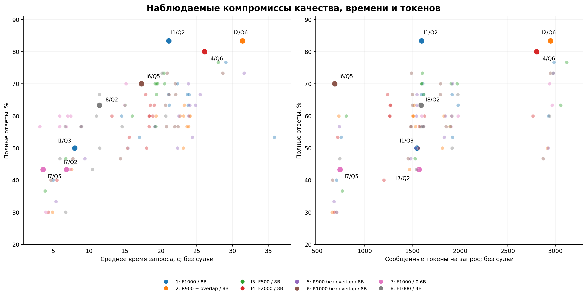
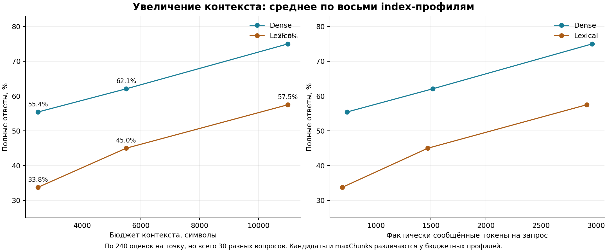

# Выводы по эксперименту 27–28 октября 2026 года

Источник: `build/libs/reports/run-2026-10-27-15-22-23`. Изучены report/compare, 3119 ask-логов, 24 index-лога, сохранённые чанки и текущая реализация поиска. Новые обращения к моделям не выполнялись. Все приведённые complete/not_complete/incorrect — исходные автоматические вердикты; спорные оценки не исправлялись.

**Основной вывод.** Самое сильное наблюдаемое улучшение даёт расширенный dense-контекст. Лучший отдельный результат при этом остаётся у обычного fixed 1000 + dense. Преимущества recursive, overlap, RRF-перебора и multi-query не установлены. Маленькие embedding-модели существенно ускоряют запросы, но экономия токенов из уменьшения числа параметров не следует.

Есть два важных ограничения: судья даёт разные оценки одинаковым ответам, а добавление экспериментальных индексов меняет общую BM25-статистику и тем самым baseline retrieval. Поэтому выбирать окончательный алгоритм по разнице в один-два ответа рано.

**Объём и надёжность запуска.**

30 разных вопросов × 8 index-профилей × 13 query-профилей = 3120 оценок. Это 104 комбинации на тех же тридцати вопросах, а не 3120 независимых вопросов. Прогон длился 21 ч 6 мин 49 с: с 27 октября 15:22 до 28 октября 12:29 по Киеву. Пользователь подтвердил, что запуск дошёл до конца без изменений настроек, перезапусков, сна и заметной параллельной нагрузки.

| Результат | Число | Доля от запланированных оценок |
|---|---:|---:|
| Complete | 1818 | 58,27% |
| Not complete | 461 | 14,78% |
| Incorrect | 838 | 26,86% |
| Без оценки из-за ошибки | 3 | 0,096% |

Две ошибки произошли при разборе JSON судьи, одна — при разборе JSON ответа. Ошибок индексации не было. Все 24 индекса соответствуют текущим хешам книг и index-профилей; все тексты из ask-логов сверены с сохранёнными чанками.

Общие 58,27% нельзя сравнивать с прежними 60% как ухудшение системы: изменился состав матрицы. На прежних 240 ячейках complete почти не изменился: 144 → 145. Но вердикт изменился в 64 ячейках, что показывает нестабильность отдельных результатов при близком общем среднем.

**Конфигурации для дальнейшей проверки.**

Время ниже — среднее ask, без судьи. Токены — сообщённая приложением сумма embedding-query и generation input/output, без судьи. Это разные операции, поэтому сумма является счётчиком расхода, а не эквивалентом вычислений.

| Index / Query | Конфигурация | C / N / I | Время | Токены |
|---|---|---:|---:|---:|
| **1 / 2** | Fixed 1000, embedding 8B, dense 5500 | **25 / 3 / 2** | **21,09 с** | **1595** |
| 2 / 6 | Recursive 900 + overlap 100, dense 11000 | 25 / 3 / 2 | 31,38 с | 2948 |
| 4 / 6 | Fixed 2000, dense 11000 | 24 / 3 / 3 | 26,10 с | 2802 |
| **6 / 5** | Recursive 1000 без overlap, dense 2500 | **21 / 4 / 5** | **17,31 с** | **684** |
| 8 / 2 | Fixed 1000, embedding 4B, dense 5500 | 19 / 5 / 6 | 11,46 с | 1592 |
| 7 / 2 | Fixed 1000, embedding 0.6B, dense 5500 | 13 / 4 / 13 | 6,84 с | 1570 |

I1/Q2 — главный baseline качества. I6/Q5 — интересный кандидат для малого токенного бюджета: примерно на 57% меньше токенов при четырёх потерянных complete из 30. I8/Q2 — компромисс по времени, который требует повторного измерения качества. I2/Q6 полезен как проверка полноты контекста, хотя в данном прогоне I1/Q2 даёт столько же complete дешевле и быстрее.

Это кандидаты из исследовательского отбора, а не доказанные победители на новых данных. Средние по запросам не включают амортизацию индексации.

**1. Расширение контекста — наиболее убедительный фактор.**

Для dense профиль Q6 вместо Q2 даёт 180/240 complete вместо 149/240: +12,92 процентного пункта. Улучшены 55 ячеек, ухудшены 24. Средние сообщённые токены растут примерно с 1516 до 2965, время — с 17,87 до 26,24 с.

В условном анализе этих тридцати вопросов разница сохраняется после группировки по вопросу и поправки Holm на 16 факторных сравнений: bootstrap-интервал +7,08…+18,33 п.п., скорректированное permutation p≈0,0144. Это исследовательская оценка для данных трёх книг, не гарантия переноса на новые документы.

Q6 меняет бюджет 5500→11000 символов и увеличивает candidateLimit/maxChunks; корректнее называть результат эффектом расширенного профиля. Настоящий токенный лимит в приложении ещё не реализован.

Для lexical направление такое же: 108→138 complete из 240. После той же поправки p≈0,0578, поэтому строгого вывода на уровне 0,05 здесь нет. Кроме того, lexical повторяет одинаковые контексты для трёх embedding-профилей и тем самым сильнее взвешивает fixed 1000. При равном весе шести разных layout и усреднении повторов этого layout прирост около +10,74 п.п.

Но «всегда давать больше текста» тоже не следует из результатов: I1/Q2 имеет 25 complete, I1/Q6 — 23. Более широкий контекст восстанавливает одни ответы и портит другие. У I1 при переходе Q2→Q6 есть три улучшения и пять ухудшений.

**2. Фиксированное разбиение остаётся сильным базовым методом.**

При усреднении по всем 13 query-профилям fixed 500 даёт 245/390 complete, fixed 1000 — 244/390. Разница — одна оценка; доказанного преимущества 500 нет. При этом число векторов удваивается: 7610 против 3806, а объём самих float32-векторов растёт с 59,47 до 118,91 MiB.

Fixed 2000 даёт меньше векторов и более дешёвую индексацию, но средний complete ниже: 223/390. С расширенным dense он всё же достигает 24/30 и даёт единственный complete на вопрос о Bulstrode/Raffles. Значит, взаимодействие длины чанка и объёма контекста существенно; одного «лучшего размера» этот запуск не установил.

Recursive 900 с overlap получает 220/390, без overlap — 224/390. Рекурсивный target 1000 без overlap — 236/390. Сильного общего выигрыша этих вариантов относительно fixed не обнаружено. Recursive здесь не равен embedding-based semantic chunking. Полезность дешёвых fixed baselines согласуется с выводом о неуниверсальности выигрыша более сложного chunking в [Qu et al., NAACL Findings 2025](https://aclanthology.org/2025.findings-naacl.114/).

**3. Маленькие embeddings ускоряют выполнение, но не сокращают текстовый бюджет.**

На одном layout и Q2 модели 8B / 4B / 0.6B дают 25 / 19 / 13 complete, среднее время 21,09 / 11,46 / 6,84 с. Recall@5 при одинаковой gold-разметке составляет 0,577 / 0,549 / 0,336. Особенно заметна потеря retrieval-качества у 0.6B.

Для 0.6B и 4B полная индексация трёх книг потребила одинаковые 938148 входных токенов. Время — 637,97 и 1169,88 с; float32-векторы — 14,87 и 37,17 MiB. Это прямой пример: модель меньшего размера экономит время и объём векторов, а не обязательно токены.

Полной новой индексации baseline 8B/fixed1000 в этом запуске нет: индексы были SKIPPED. Поэтому сравнивать её «нулевую стоимость» с новыми моделями нельзя. Answering- и judge-модели в эксперименте не варьировались.

**4. RRF-подбор, широкий пул и rewrite пока не дали убедительного выигрыша.**

По имеющейся матрице Q1/Q9/Q10/Q11 дают соответственно 149/146/154/147 complete из 240. Небольшое преимущество RRF k=30 не подтверждено статистикой. Пул по 50 кандидатов на канал сам по себе качество не повысил.

Два rewrite против обычного hybrid: 151 против 149 complete, примерно 1900 против 1531 токена. Это пока слабое основание оплачивать дополнительную генерацию. Один rewrite 4B вместо одного rewrite 9B даёт 139 вместо 143 complete; среднее время даже выше, 20,10 против 18,69 с, а сообщённые токены почти одинаковы. Возможный вклад загрузки и размещения моделей требует отдельных таймеров; имеющиеся логи не устанавливают причину.

**5. Сложные вопросы по-прежнему ограничивают качество.**

| Категория | Complete | Доля |
|---|---:|---:|
| exact-term | 776/1040 | 74,6% |
| paraphrase | 605/936 | 64,6% |
| multi-fact | 201/520 | 38,7% |
| multi-hop | 74/312 | 23,7% |
| unanswerable | 162/312 | 51,9% по строгой рубрике |

Multi-hop — это всё ещё только три разных вопроса. Расширенный dense даёт на них 15/24 complete, обычный dense — 10/24. Обычный lexical — 1/24, расширенный lexical — 2/24. Дополнительный текст помогает прежде всего при достаточно хорошем первоначальном ранжировании.

На неотвечаемых вопросах нет ни одного incorrect: 162 complete и 150 not_complete. Низкий strict-complete здесь связан с формулировками отказа, а не с 150 выдуманными фактами. Отдельно нужно измерять корректность воздержания и соответствие формальной политике.

**6. Качество связано с покрытием доказательств.**

Для сопоставления разных размеров чанков дополнительно спроецированы общие source evidence spans из предыдущего исследования на фактически переданный контекст. Это вспомогательная разметка с явно заданными альтернативами, а не новый валидированный benchmark.

При полном покрытии выбранных evidence-фрагментов complete встречается в 1092/1165 случаев (93,7%). При неполном — в 564/1642 (34,3%). Ассоциация сильная, но причинного вывода из неё нет: оценка автоматическая, разметка неполная, вопросы повторяются.

Иллюстрация механизма: I2/Q2 находит для Аргоса чанки 624/625 и другие, но не 626 со смертью. Ответ неверен. I2/Q6 включает 626 седьмым и отвечает полностью. Такое доказательство невидимо для Recall@5, хотя уже присутствует в реальном контексте.

**Практическое решение.** Сохранить I1/Q2 как основной baseline; перепроверить I6/Q5 для малого бюджета и I8/Q2 для меньшего времени. Следующее развитие — выборочное восстановление недостающих доказательств, а не ещё один полный перебор десятков похожих профилей. До следующего дорогого запуска следует стабилизировать судью, изолировать lexical-статистику и добавить повторные измерения.

**Материалы.**

- [Все профили, таблицы и затраты](profiles.md).
- [Ошибки, судья, контроль одинаковых контекстов и BM25](evaluation-audit.md).
- [Следующий эксперимент и научная постановка](next-experiment.md).
- [Методика, статистика и определения](methodology.md).
- [Построчный разбор 3120 оценок](question-diagnostics.csv).
