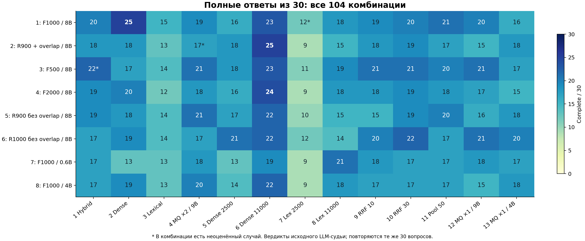

# Профили, результаты и затраты

Все C/N/I — исходные автоматические вердикты. Время — средний ask без judge. Токены — смешанный сообщённый query-счётчик; его состав описан в [методике](methodology.md). Показатели с ошибкой не дополнялись предположительными вердиктами.

Каждая из 104 комбинаций оценена на тех же 30 вопросах. Поиск по одному сохранённому индексу ограничивает каждый вопрос одной книгой. Результаты для всего многофайлового корпуса напрямую не измерялись.

**Агрегаты index-профилей.** У каждой строки одинаковые 13 query-профилей и 390 оценок. Это сравнение конкретной смеси настроек; для сравнения embeddings нужно исключать lexical, который от embedding не зависит.

| I | Разбиение / embedding | C/N/I/E из 390 | Ask, с | Query tokens | Векторов | Vector MiB | Новая индексация, с | Index tokens |
|---|---|---|---|---|---|---|---|---|
| 1 | Fixed 1000 / 8B | 244/47/98/1 | 20,54 | 1752 | 3806 | 59,47 | SKIPPED | 0 |
| 2 | Recursive 900 + overlap 100 / 8B | 220/63/106/1 | 20,49 | 1679 | 5061 | 79,08 | SKIPPED | 0 |
| 3 | Fixed 500 / 8B | 245/57/87/1 | 17,44 | 1773 | 7610 | 118,91 | 2315,70 | 945554 |
| 4 | Fixed 2000 / 8B | 223/56/111/0 | 16,32 | 1479 | 1904 | 29,75 | 1615,15 | 934422 |
| 5 | Recursive 900 без overlap / 8B | 224/69/97/0 | 20,94 | 1703 | 5061 | 79,08 | 1852,99 | 935830 |
| 6 | Recursive 1000 без overlap / 8B | 236/56/98/0 | 18,81 | 1655 | 4526 | 70,72 | 1780,54 | 935292 |
| 7 | Fixed 1000 / 0.6B | 210/63/117/0 | 7,46 | 1745 | 3806 | 14,87 | 637,97 | 938148 |
| 8 | Fixed 1000 / 4B | 216/50/124/0 | 11,42 | 1749 | 3806 | 37,17 | 1169,88 | 938148 |

Vector MiB учитывает только BLOB векторов. 8B использует 4096 float32-компонент, 4B — 2560, 0.6B — 1024. SKIPPED означает повторное использование построенного индекса, а не измеренную нулевую стоимость построения. I3/I4 построены в одном прогоне: fixed 2000 даёт примерно вчетверо меньше векторов и быстрее индексируется, чем fixed 500, но это не доказывает превосходства по качеству.

**Агрегаты query-профилей.** Каждая строка содержит по восемь index-профилей: 240 оценок, 30 разных вопросов. Для lexical три строки layout fixed1000 являются повторениями тех же prompts; сравнения по query отражают именно эту смесь весов.

| Q | Настройка | C/N/I/E из 240 | C, % | Ask, с | Query tokens |
|---|---|---|---|---|---|
| 1 | Hybrid 5500, k=60 | 149/34/56/1 | 62,08 | 19,69 | 1531 |
| 2 | Dense 5500 | 149/40/51/0 | 62,08 | 17,87 | 1516 |
| 3 | Lexical 5500 | 108/36/96/0 | 45,00 | 7,85 | 1472 |
| 4 | Hybrid + 2 rewrite 9B | 151/37/51/1 | 62,92 | 18,61 | 1900 |
| 5 | Dense 2500 | 133/36/71/0 | 55,42 | 14,25 | 737 |
| 6 | Dense 11000 | 180/27/33/0 | 75,00 | 26,24 | 2965 |
| 7 | Lexical 2500 | 81/38/120/1 | 33,75 | 4,86 | 694 |
| 8 | Lexical 11000 | 138/29/73/0 | 57,50 | 15,46 | 2917 |
| 9 | Hybrid k=10 | 146/33/61/0 | 60,83 | 17,64 | 1525 |
| 10 | Hybrid k=30 | 154/39/47/0 | 64,17 | 17,20 | 1532 |
| 11 | Hybrid pool 50 | 147/38/55/0 | 61,25 | 18,33 | 1535 |
| 12 | Hybrid + 1 rewrite 9B | 143/37/60/0 | 59,58 | 18,69 | 1833 |
| 13 | Hybrid + 1 rewrite 4B | 139/37/64/0 | 57,92 | 20,10 | 1834 |

Q5–Q8 используют candidateLimit/maxChunks=32. У Q1–Q4 и Q9–Q13 maxChunks=10; глубина кандидатов обычно 20, у Q11 — 50 на канал. Все бюджеты в названии — символы. I4/Q5 может передать примерно один 2000-символьный чанк; I3/Q6 — около девятнадцати 500-символьных. Поэтому эффективность зависит от сочетания двух профилей.

**Парные факторные сравнения.** Положительная разница означает преимущество второго варианта. Интервалы условны на эти книги; ресэмплинг выполняется по вопросу. Holm исправляет множественность 16 указанных сравнений, но не selection bias выбора победителей из всей матрицы. Подробности — в methodology.md.

| Контраст | Пар / разных вопросов | Δ complete, п.п. | 95% bootstrap interval | Permutation p | Holm p |
|---|---|---|---|---|---|
| Dense 5500 → 2500 | 240 / 30 | -6,67 | -13,75…0,43 | 0,10724 | 1,00000 |
| Dense 5500 → 11000 | 240 / 30 | 12,92 | 7,08…18,33 | 0,00090 | 0,01440 |
| Lexical 5500 → 2500 | 240 / 30 | -11,25 | -20,42…-2,08 | 0,05075 | 0,65972 |
| Lexical 5500 → 11000 | 240 / 30 | 12,50 | 5,42…19,17 | 0,00385 | 0,05775 |
| RRF 60 → 10 | 240 / 30 | -1,25 | -5,00…2,50 | 0,72696 | 1,00000 |
| RRF 60 → 30 | 240 / 30 | 2,08 | -0,83…5,42 | 0,31308 | 1,00000 |
| Hybrid pool 20 → 50 | 240 / 30 | -0,83 | -5,83…3,75 | 0,86961 | 1,00000 |
| Hybrid → 2 rewrite | 240 / 30 | 0,83 | -2,50…4,17 | 0,80696 | 1,00000 |
| 2 → 1 rewrite 9B | 240 / 30 | -3,33 | -8,33…1,67 | 0,29139 | 1,00000 |
| Rewrite 9B → 4B | 240 / 30 | -1,67 | -6,67…3,33 | 0,63962 | 1,00000 |
| Fixed 1000 → 500 | 390 / 30 | 0,26 | -7,95…8,72 | 1,00000 | 1,00000 |
| Fixed 1000 → 2000 | 390 / 30 | -5,38 | -11,28…0,26 | 0,10349 | 1,00000 |
| Recursive overlap 100 → 0 | 390 / 30 | 1,03 | -5,13…6,67 | 0,81461 | 1,00000 |
| Fixed 1000 → recursive 1000 без overlap | 390 / 30 | -2,05 | -12,05…7,69 | 0,74041 | 1,00000 |
| Embedding 8B → 0.6B, без lexical | 300 / 30 | -10,67 | -20,00…-1,67 | 0,04680 | 0,65517 |
| Embedding 8B → 4B, без lexical | 300 / 30 | -7,67 | -15,00…-1,00 | 0,05430 | 0,65972 |

**Результаты по вопросам.** Эти строки помогают выбрать stress cases, но нельзя строить новый test только из провалов исследуемого метода. У unanswerable частичный вердикт часто отражает политику формулировки отказа.

| Книга ID | Вопрос | C/N/I/E из 104 |
|---|---|---|
| 1 | argos | 61/4/38/1 |
| 1 | bow-contest | 78/12/14/0 |
| 1 | calypso | 88/4/12/0 |
| 1 | calypso-and-argos | 20/25/59/0 |
| 1 | euryclea-scar | 85/6/13/0 |
| 1 | lotus-eaters | 104/0/0/0 |
| 1 | olive-tree-bed | 47/16/41/0 |
| 1 | scylla | 99/2/3/0 |
| 1 | sirens | 93/1/10/0 |
| 1 | unanswerable-tuition | 32/72/0/0 |
| 2 | ahab-leg | 34/11/59/0 |
| 2 | gold-ounce | 79/3/22/0 |
| 2 | ishmael-survival | 23/17/64/0 |
| 2 | life-buoy | 88/16/0/0 |
| 2 | narrator | 36/5/63/0 |
| 2 | pequod | 53/6/45/0 |
| 2 | queequeg-role | 99/1/4/0 |
| 2 | starbuck-position | 85/9/10/0 |
| 2 | unanswerable-birth-year | 58/46/0/0 |
| 2 | white-whale-features | 37/28/39/0 |
| 3 | bulstrode-raffles | 1/23/80/0 |
| 3 | casaubon-codicil | 73/15/16/0 |
| 3 | casaubon-work | 68/6/29/1 |
| 3 | dorothea-choice | 31/22/50/1 |
| 3 | dorothea-sister | 93/0/11/0 |
| 3 | featherstone-heir | 97/2/5/0 |
| 3 | fred-mary | 36/13/55/0 |
| 3 | lydgate-fate | 34/18/52/0 |
| 3 | lydgate-research | 14/46/44/0 |
| 3 | unanswerable-publication-sales | 72/32/0/0 |

**Все комбинации.** «Ref full» — число отвечаемых случаев с полным покрытием выбранных source evidence groups из 27. Это вспомогательная проекция из evaluation-audit/methodology, не истинная семантическая полнота. R@5 — исходная chunkId-метрика, зависящая от размера чанка. E — число неоценённых случаев. Для I1/Q7 доступно только 26 отвечаемых успешных ask, остальные комбинации имеют 27.

**I1: Fixed 1000 / 8B.**

| Q | C/N/I/E | Ask mean, с | Ask p95, с | Tokens | R@5 | Чанков в контексте | Ref full |
|---|---|---|---|---|---|---|---|
| 1 | 20/2/8/0 | 23,94 | 33,08 | 1616 | 0,531 | 5,0 | 12/27 |
| 2 | 25/3/2/0 | 21,09 | 28,20 | 1595 | 0,577 | 5,0 | 12/27 |
| 3 | 15/2/13/0 | 7,99 | 11,56 | 1548 | 0,380 | 5,0 | 10/27 |
| 4 | 19/5/6/0 | 23,80 | 29,66 | 1978 | 0,494 | 5,0 | 12/27 |
| 5 | 16/4/10/0 | 17,02 | 21,61 | 751 | 0,451 | 2,0 | 10/27 |
| 6 | 23/2/5/0 | 29,05 | 36,17 | 2986 | 0,577 | 10,0 | 16/27 |
| 7 | 12/4/13/1 | 4,99 | 8,37 | 703 | 0,244 | 2,0 | 5/26 |
| 8 | 18/3/9/0 | 14,55 | 17,23 | 2927 | 0,380 | 10,0 | 13/27 |
| 9 | 19/3/8/0 | 21,16 | 29,41 | 1601 | 0,549 | 5,0 | 12/27 |
| 10 | 20/5/5/0 | 21,08 | 29,58 | 1596 | 0,531 | 5,0 | 12/27 |
| 11 | 21/4/5/0 | 22,33 | 31,25 | 1608 | 0,457 | 5,0 | 11/27 |
| 12 | 20/4/6/0 | 23,70 | 33,75 | 1917 | 0,512 | 5,0 | 12/27 |
| 13 | 16/6/8/0 | 35,82 | 46,29 | 1920 | 0,457 | 5,0 | 11/27 |

**I2: Recursive 900 + overlap 100 / 8B.**

| Q | C/N/I/E | Ask mean, с | Ask p95, с | Tokens | R@5 | Чанков в контексте | Ref full |
|---|---|---|---|---|---|---|---|
| 1 | 18/4/8/0 | 24,11 | 37,57 | 1510 | 0,469 | 5,4 | 12/27 |
| 2 | 18/4/8/0 | 23,18 | 34,67 | 1503 | 0,472 | 5,4 | 12/27 |
| 3 | 13/6/11/0 | 7,57 | 12,17 | 1470 | 0,262 | 5,4 | 7/27 |
| 4 | 17/4/8/1 | 23,63 | 33,98 | 1894 | 0,460 | 5,3 | 12/27 |
| 5 | 18/5/7/0 | 19,33 | 34,19 | 728 | 0,364 | 2,2 | 9/27 |
| 6 | 25/3/2/0 | 31,38 | 43,69 | 2948 | 0,472 | 11,3 | 16/27 |
| 7 | 9/6/15/0 | 4,91 | 8,71 | 659 | 0,225 | 2,1 | 6/27 |
| 8 | 15/3/12/0 | 15,34 | 19,24 | 2914 | 0,262 | 11,4 | 9/27 |
| 9 | 18/5/7/0 | 22,69 | 33,58 | 1509 | 0,488 | 5,3 | 14/27 |
| 10 | 19/6/5/0 | 23,25 | 36,97 | 1519 | 0,469 | 5,4 | 12/27 |
| 11 | 17/5/8/0 | 23,88 | 38,71 | 1532 | 0,432 | 5,4 | 12/27 |
| 12 | 15/7/8/0 | 23,14 | 37,47 | 1815 | 0,469 | 5,3 | 11/27 |
| 13 | 18/5/7/0 | 24,03 | 37,62 | 1832 | 0,472 | 5,3 | 12/27 |

**I3: Fixed 500 / 8B.**

| Q | C/N/I/E | Ask mean, с | Ask p95, с | Tokens | R@5 | Чанков в контексте | Ref full |
|---|---|---|---|---|---|---|---|
| 1 | 22/4/3/1 | 20,42 | 26,82 | 1603 | 0,494 | 9,0 | 16/27 |
| 2 | 17/8/5/0 | 19,30 | 23,43 | 1585 | 0,463 | 9,0 | 10/27 |
| 3 | 14/6/10/0 | 6,73 | 9,48 | 1528 | 0,253 | 9,0 | 8/27 |
| 4 | 21/4/5/0 | 19,57 | 22,71 | 1970 | 0,494 | 9,0 | 15/27 |
| 5 | 18/4/8/0 | 16,02 | 18,58 | 806 | 0,395 | 4,0 | 7/27 |
| 6 | 23/4/3/0 | 27,99 | 31,72 | 3118 | 0,463 | 19,0 | 15/27 |
| 7 | 11/5/14/0 | 3,88 | 5,66 | 763 | 0,204 | 4,0 | 3/27 |
| 8 | 19/3/8/0 | 15,02 | 17,36 | 3055 | 0,253 | 19,0 | 12/27 |
| 9 | 21/2/7/0 | 20,51 | 30,68 | 1595 | 0,488 | 9,0 | 16/27 |
| 10 | 21/4/5/0 | 19,21 | 21,65 | 1599 | 0,494 | 9,0 | 16/27 |
| 11 | 20/6/4/0 | 19,40 | 21,22 | 1617 | 0,469 | 9,0 | 15/27 |
| 12 | 21/3/6/0 | 19,42 | 22,12 | 1906 | 0,451 | 9,0 | 15/27 |
| 13 | 17/4/9/0 | 19,22 | 21,66 | 1899 | 0,438 | 9,0 | 15/27 |

**I4: Fixed 2000 / 8B.**

| Q | C/N/I/E | Ask mean, с | Ask p95, с | Tokens | R@5 | Чанков в контексте | Ref full |
|---|---|---|---|---|---|---|---|
| 1 | 19/3/8/0 | 19,08 | 23,49 | 1265 | 0,444 | 2,0 | 11/27 |
| 2 | 20/4/6/0 | 17,89 | 20,90 | 1240 | 0,500 | 2,0 | 13/27 |
| 3 | 12/2/16/0 | 5,52 | 8,46 | 1201 | 0,315 | 2,0 | 8/27 |
| 4 | 18/5/7/0 | 18,36 | 22,05 | 1628 | 0,426 | 2,0 | 11/27 |
| 5 | 16/6/8/0 | 15,60 | 17,57 | 717 | 0,315 | 1,0 | 9/27 |
| 6 | 24/3/3/0 | 26,10 | 29,88 | 2802 | 0,704 | 5,0 | 19/27 |
| 7 | 9/5/16/0 | 4,33 | 7,30 | 680 | 0,278 | 1,0 | 7/27 |
| 8 | 18/4/8/0 | 13,17 | 16,79 | 2764 | 0,438 | 5,0 | 11/27 |
| 9 | 18/3/9/0 | 18,39 | 21,36 | 1264 | 0,444 | 2,0 | 11/27 |
| 10 | 19/4/7/0 | 18,52 | 22,79 | 1270 | 0,444 | 2,0 | 11/27 |
| 11 | 18/4/8/0 | 18,89 | 23,40 | 1262 | 0,444 | 2,0 | 11/27 |
| 12 | 17/7/6/0 | 18,37 | 22,52 | 1571 | 0,389 | 2,0 | 10/27 |
| 13 | 15/6/9/0 | 18,01 | 20,64 | 1563 | 0,407 | 2,0 | 10/27 |

**I5: Recursive 900 без overlap / 8B.**

| Q | C/N/I/E | Ask mean, с | Ask p95, с | Tokens | R@5 | Чанков в контексте | Ref full |
|---|---|---|---|---|---|---|---|
| 1 | 19/7/4/0 | 24,02 | 36,94 | 1548 | 0,522 | 6,2 | 15/27 |
| 2 | 18/6/6/0 | 22,53 | 35,20 | 1542 | 0,515 | 6,3 | 13/27 |
| 3 | 14/5/11/0 | 9,41 | 16,75 | 1482 | 0,287 | 6,2 | 8/27 |
| 4 | 21/3/6/0 | 23,84 | 37,59 | 1920 | 0,522 | 6,1 | 15/27 |
| 5 | 17/4/9/0 | 19,18 | 32,44 | 734 | 0,429 | 2,6 | 9/27 |
| 6 | 22/4/4/0 | 31,60 | 44,32 | 2978 | 0,515 | 12,9 | 15/27 |
| 7 | 10/5/15/0 | 5,39 | 11,39 | 676 | 0,250 | 2,5 | 5/27 |
| 8 | 15/7/8/0 | 15,40 | 19,16 | 2925 | 0,287 | 12,7 | 10/27 |
| 9 | 15/7/8/0 | 22,32 | 32,69 | 1534 | 0,549 | 6,2 | 15/27 |
| 10 | 19/5/6/0 | 24,83 | 39,93 | 1570 | 0,522 | 6,2 | 15/27 |
| 11 | 20/4/6/0 | 25,47 | 41,40 | 1548 | 0,485 | 6,0 | 12/27 |
| 12 | 16/5/9/0 | 24,39 | 41,18 | 1834 | 0,522 | 6,1 | 15/27 |
| 13 | 18/7/5/0 | 23,88 | 38,00 | 1847 | 0,522 | 6,2 | 15/27 |

**I6: Recursive 1000 без overlap / 8B.**

| Q | C/N/I/E | Ask mean, с | Ask p95, с | Tokens | R@5 | Чанков в контексте | Ref full |
|---|---|---|---|---|---|---|---|
| 1 | 17/4/9/0 | 22,40 | 34,03 | 1486 | 0,552 | 5,3 | 13/27 |
| 2 | 19/6/5/0 | 20,66 | 27,57 | 1502 | 0,596 | 5,5 | 15/27 |
| 3 | 14/3/13/0 | 7,72 | 11,19 | 1455 | 0,355 | 5,5 | 8/27 |
| 4 | 17/7/6/0 | 20,78 | 28,23 | 1853 | 0,571 | 5,3 | 14/27 |
| 5 | 21/4/5/0 | 17,31 | 25,99 | 684 | 0,522 | 2,1 | 13/27 |
| 6 | 22/4/4/0 | 28,65 | 35,77 | 2947 | 0,596 | 11,4 | 16/27 |
| 7 | 12/4/14/0 | 4,67 | 8,16 | 663 | 0,343 | 2,2 | 8/27 |
| 8 | 14/6/10/0 | 14,38 | 16,77 | 2870 | 0,355 | 11,5 | 10/27 |
| 9 | 20/5/5/0 | 21,15 | 28,08 | 1499 | 0,590 | 5,3 | 14/27 |
| 10 | 22/4/4/0 | 20,87 | 28,21 | 1489 | 0,552 | 5,3 | 13/27 |
| 11 | 17/4/9/0 | 21,94 | 33,99 | 1481 | 0,515 | 5,3 | 12/27 |
| 12 | 21/3/6/0 | 21,99 | 31,40 | 1795 | 0,441 | 5,3 | 10/27 |
| 13 | 20/2/8/0 | 22,07 | 32,48 | 1792 | 0,460 | 5,3 | 10/27 |

**I7: Fixed 1000 / 0.6B.**

| Q | C/N/I/E | Ask mean, с | Ask p95, с | Tokens | R@5 | Чанков в контексте | Ref full |
|---|---|---|---|---|---|---|---|
| 1 | 17/6/7/0 | 8,89 | 12,37 | 1614 | 0,429 | 5,0 | 10/27 |
| 2 | 13/4/13/0 | 6,84 | 9,38 | 1570 | 0,336 | 5,0 | 6/27 |
| 3 | 13/5/12/0 | 7,40 | 10,66 | 1550 | 0,380 | 5,0 | 10/27 |
| 4 | 18/7/5/0 | 7,45 | 9,77 | 1980 | 0,392 | 5,0 | 9/27 |
| 5 | 13/5/12/0 | 3,58 | 5,90 | 740 | 0,275 | 2,0 | 5/27 |
| 6 | 19/5/6/0 | 14,97 | 19,47 | 2966 | 0,336 | 10,0 | 10/27 |
| 7 | 9/4/17/0 | 3,98 | 5,97 | 705 | 0,253 | 2,0 | 5/27 |
| 8 | 21/0/9/0 | 15,14 | 19,84 | 2938 | 0,380 | 10,0 | 13/27 |
| 9 | 18/4/8/0 | 5,91 | 8,12 | 1599 | 0,429 | 5,0 | 10/27 |
| 10 | 17/8/5/0 | 3,14 | 7,62 | 1597 | 0,429 | 5,0 | 10/27 |
| 11 | 17/7/6/0 | 5,90 | 10,37 | 1613 | 0,429 | 5,0 | 10/27 |
| 12 | 18/4/8/0 | 7,02 | 10,46 | 1912 | 0,429 | 5,0 | 10/27 |
| 13 | 17/4/9/0 | 6,80 | 9,45 | 1903 | 0,429 | 5,0 | 10/27 |

**I8: Fixed 1000 / 4B.**

| Q | C/N/I/E | Ask mean, с | Ask p95, с | Tokens | R@5 | Чанков в контексте | Ref full |
|---|---|---|---|---|---|---|---|
| 1 | 17/4/9/0 | 14,60 | 30,60 | 1609 | 0,438 | 5,0 | 10/27 |
| 2 | 19/5/6/0 | 11,45 | 22,60 | 1592 | 0,549 | 5,0 | 11/27 |
| 3 | 13/7/10/0 | 10,47 | 17,92 | 1541 | 0,380 | 5,0 | 10/27 |
| 4 | 20/2/8/0 | 11,45 | 17,95 | 1977 | 0,438 | 5,0 | 10/27 |
| 5 | 14/4/12/0 | 5,93 | 10,15 | 739 | 0,327 | 2,0 | 7/27 |
| 6 | 22/2/6/0 | 20,16 | 27,79 | 2976 | 0,549 | 10,0 | 14/27 |
| 7 | 9/5/16/0 | 6,75 | 12,25 | 705 | 0,253 | 2,0 | 5/27 |
| 8 | 18/3/9/0 | 20,69 | 27,64 | 2939 | 0,380 | 10,0 | 13/27 |
| 9 | 17/4/9/0 | 8,97 | 13,43 | 1599 | 0,475 | 5,0 | 11/27 |
| 10 | 17/3/10/0 | 6,68 | 12,66 | 1612 | 0,438 | 5,0 | 10/27 |
| 11 | 17/4/9/0 | 8,86 | 17,67 | 1618 | 0,438 | 5,0 | 11/27 |
| 12 | 15/4/11/0 | 11,46 | 16,73 | 1916 | 0,438 | 5,0 | 10/27 |
| 13 | 18/3/9/0 | 11,01 | 18,51 | 1912 | 0,438 | 5,0 | 10/27 |
