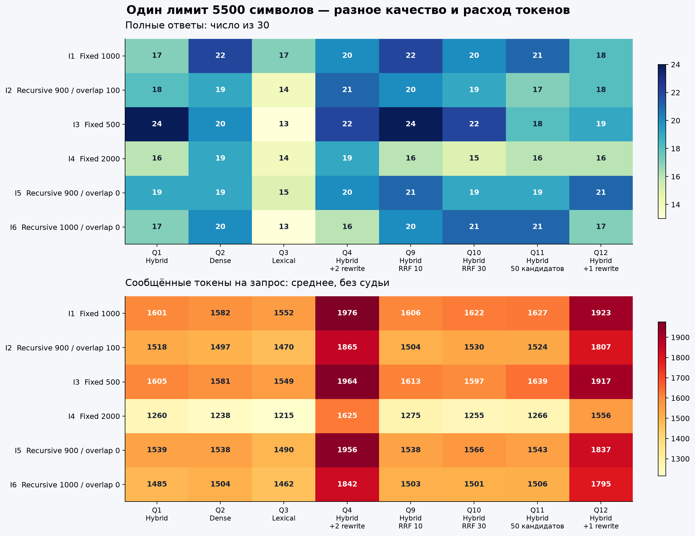
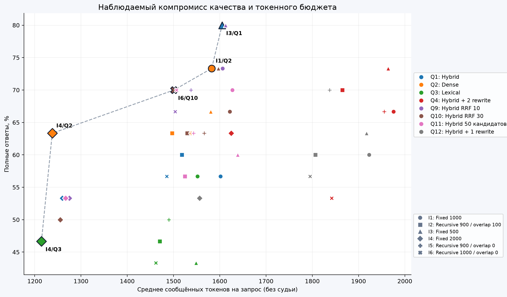
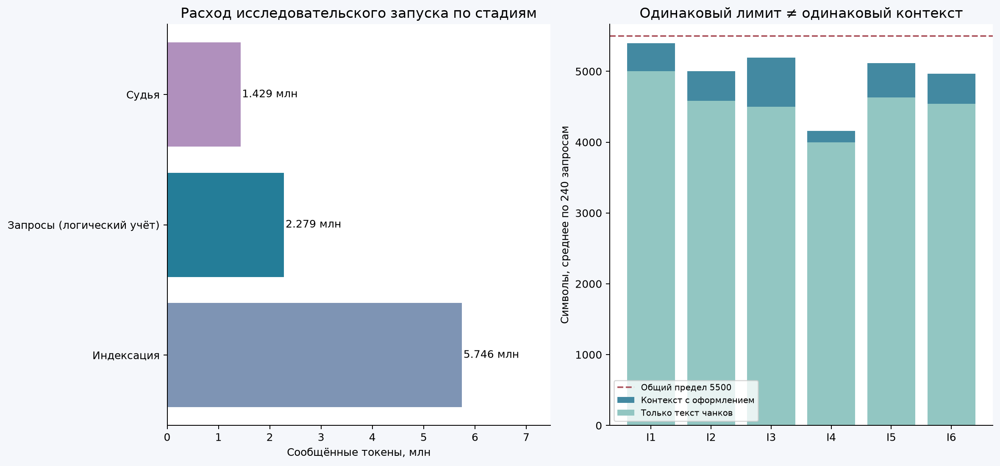
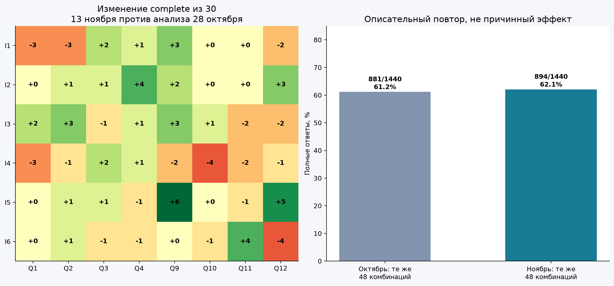
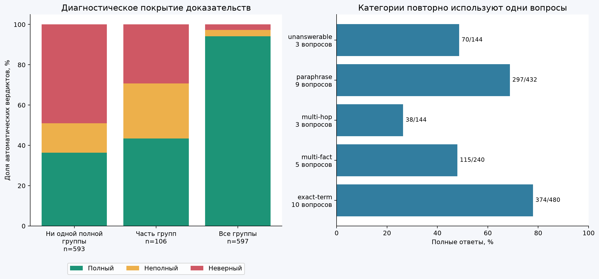
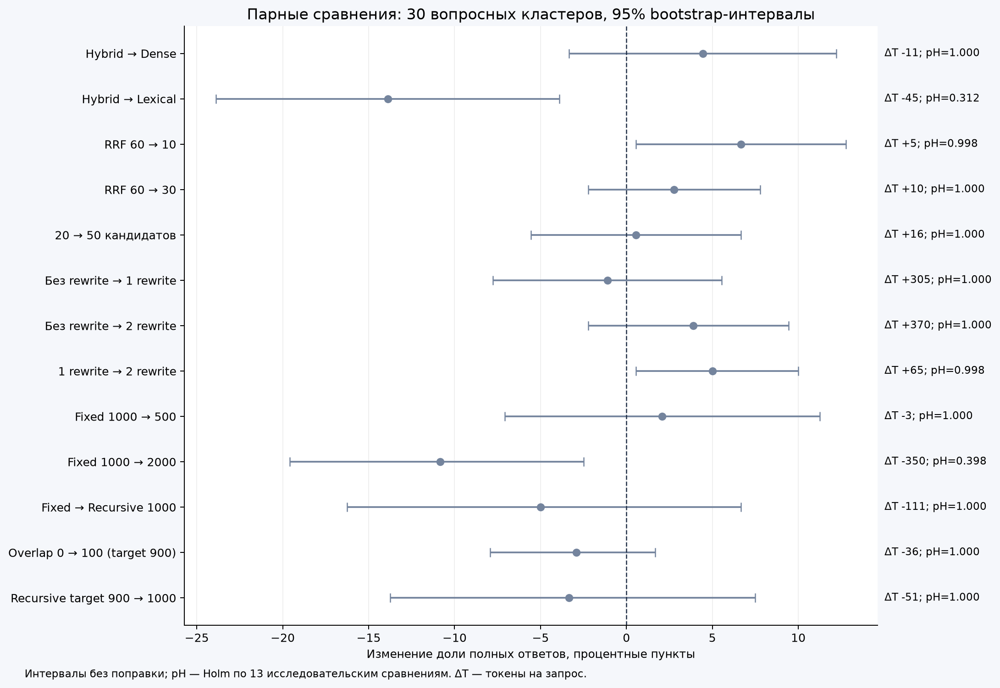

# RAG: качество ответа при ограниченном токенном бюджете

Исследование запуска `run-2026-11-13-01-00-46`. Дата анализа: 13 ноября 2026 года. Основной критерий — качество ответа относительно сообщённого расхода токенов. Время выполнения не участвует в ранжировании или выборе рекомендаций. Новые вызовы Ollama не выполнялись.

## Основные выводы

1. **Самый высокий наблюдаемый результат — fixed 500 + hybrid: 24 полных ответа из 30 при примерно 1605 токенах на запрос.** Вариант с RRF 10 тоже даёт 24/30, но меняет распределение частичных и неверных ответов. Это кандидаты для подтверждения, а не доказанные победители.
2. **Fixed 1000 + dense остаётся сильным ориентиром:** 22/30 при 1582 токенах. По сравнению с ним fixed 500 + hybrid расходует примерно на 1,4% больше токенов и даёт на два полных ответа больше. Однако в парном сравнении он исправляет шесть вопросов и портит четыре: результат не является равномерным улучшением.
3. **Крупные чанки экономят токены главным образом за счёт меньшего фактически переданного контекста.** Fixed 2000 + dense расходует на 21,8% меньше токенов, чем fixed 1000 + dense, но даёт 19 вместо 22 полных ответов и 10 вместо 4 неверных. Называть это бесплатной оптимизацией нельзя.
4. **LLM-переформулировки пока не оправдали дополнительный бюджет.** В среднем одна переформулировка добавляет около 305 сообщённых токенов относительно hybrid без rewrite, две — около 370. Устойчивое улучшение качества не установлено.
5. **Измерение остаётся главным ограничением.** На той же матрице, что и в октябре, complete вырос с 881 до 894 из 1440 — на 0,90 процентного пункта. Одновременно изменились 362 вердикта. В новом запуске есть 16 групп одинаковых ответов с противоречащими оценками судьи.
6. **Следующая полезная стратегия — точный поиск небольших фрагментов с выборочным восстановлением соседнего доказательства**, а не постоянное увеличение чанков или overlap. Это проверяемая гипотеза, а не уже полученный прирост.

## 1. Что именно измерено

Три книги: Odyssey, Moby-Dick и Middlemarch; по десять вопросов. Шесть index-профилей × восемь query-профилей × тридцать вопросов = **1440 оценок**. У всех query-профилей `contextCharBudget=5500`, `maxChunks=10`. Все индексы используют `qwen3-embedding:8b`.

| Результат автоматического судьи | Число | Доля |
| --- | ---: | ---: |
| Полный ответ — complete | 894 | 62,08% |
| Неполный — not_complete | 207 | 14,38% |
| Неверный — incorrect | 339 | 23,54% |
| Техническая ошибка | 0 | 0% |

Это оценки одного и того же набора из **30 разных вопросов**, повторённого 48 раз. Они не образуют 1440 независимых тестовых вопросов. Ноль технических ошибок подтверждает завершение конвейера, но не отсутствие фактических ошибок.

| Индекс | Способ разбиения |
| --- | --- |
| I1 | Fixed 1000 символов, без overlap |
| I2 | Recursive: target 900, max 1000, overlap 100 |
| I3 | Fixed 500, без overlap |
| I4 | Fixed 2000, без overlap |
| I5 | Recursive: target 900, max 1000, overlap 0 |
| I6 | Recursive: target 1000, max 1000, overlap 0 |

| Query | Поиск |
| --- | --- |
| Q1 | Hybrid, 20 dense + 20 lexical кандидатов, RRF 60 |
| Q2 | Dense, 20 кандидатов |
| Q3 | Lexical, 20 кандидатов |
| Q4 | Q1 + до двух переформулировок через `qwen3.5:9b` |
| Q9 / Q10 | Q1 с RRF 10 / 30 |
| Q11 | Hybrid, по 50 кандидатов, RRF 60 |
| Q12 | Q1 + до одной переформулировки через `qwen3.5:9b` |

Кандидаты выбираются отдельно в каждом индексе, но каждая оценка `report` ищет только в одном указанном индексе одной книги. Исследование не проверяет поиск по смешанному корпусу нескольких книг. Переформулировки расширяют dense-канал; lexical использует исходный вопрос.

## 2. Методология и проверка исходных данных

**Источники.** Использованы `report.json`, `compare.json`, все 1440 связанных ask-логов, 18 index-логов, SQLite в режиме только чтения, исходные книги, текущие профили и датасеты. Для исторического сравнения — сохранённые CSV двух октябрьских исследований. Для диагностики доказательств — их заранее подготовленная разметка цитат и групп.

**Проверки целостности.** Пересчитанные C/N/I и средние retrieval-метрики совпали с `compare.json`. Все токенные счётчики вопросов совпали с ask-логами. Тексты и ID всех переданных чанков совпали с SQLite. Хеши всех 18 индексов соответствуют текущим книгам и профилям. У шести сохранённых index- и восьми query-профилей SHA-256 совпадает с октябрьским manifest. Тексты книг совпали с исходниками разметки evidence; проверены точные цитаты и смещения. Список входов и SHA-256 приведён в [provenance.json](provenance.json).

**Качество.** Главная метрика — доля `complete`; `not_complete` и `incorrect` обязательно показываются отдельно. Средний judge-score не используется как независимая метрика: он лишь перекодирует эти же вердикты в 10/5/0. Все исходные вердикты сохранены, включая спорные. Ручной переоценки и скрытого исправления результатов нет.

**Токены.** На запрос берётся `ask.inputTokens + ask.outputTokens`: эмбеддинг вопроса, rewrite при его наличии и генерация ответа. Судья и индексация показываются отдельно. Это сообщённые счётчики разных операций, а не универсальная мера FLOPs, энергопотребления или денежной стоимости. Отдельный input/output для каждой стадии приложение не сохраняет, поэтому точное разложение внутри ask недоступно.

**Кеш rewrite.** `QueryExpansionService` кеширует весь `LlmResult`, включая его прежний `TokenUsage`, и возвращает тот же usage при cache hit. Для каждой пары «вопрос / режим rewrite» результаты переиспользуются между шестью индексами. Поэтому сумма ask-логов содержит повторный логический учёт rewrite, даже если нового вызова не было. Здесь это явно называется **сообщённым/логическим расходом**. Фактический общий расход физических rewrite-вызовов восстановить нельзя. Разницу Q4/Q12 с обычными профилями нельзя целиком выдавать за измеренную дополнительную физическую стоимость этого запуска.

**Парные сравнения.** Для изменения query-профиля каждый вопрос сначала даёт среднюю разницу complete по шести индексам; для изменения индекса — по восьми query-профилям. Единица ресэмплинга — вопрос, а не строка. Использованы 10 000 bootstrap-повторов с сохранением трёх страт-книг по десять вопросов и 20 000 кластерных sign-flip-перестановок. Seed — `20261113`. Для 13 исследовательских сравнений применена поправка Holm. Bootstrap-интервалы 95% не скорректированы одновременно; их не следует интерпретировать как множественно скорректированные тесты.

Интервалы условны на эти три книги. При только трёх документах они не оценивают перенос на произвольные новые документы. Сравнения не были пререгистрированы; выбор лучших из 48 комбинаций создаёт оптимизм отбора. **Ни один из 13 контрастов не проходит порог Holm 0,05.** Это не доказательство эквивалентности методов; данных и стабильности измерения пока недостаточно.

**Evidence-диагностика.** Разметка точных цитат проецируется на реальные исходные позиции выбранных чанков. Покрытие цитаты — длина объединения пересечений / длина цитаты. Группа покрыта, если хотя бы одна допустимая цитата покрыта не менее чем на 80%; объединение учитывает соседние чанки и не считает overlap дважды. Использованы прежние группировки альтернатив; порог 80% — явно заданная исследовательская эвристика. Это не человечески валидированная мера смысловой полноты. Отсутствие размеченной цитаты не означает отсутствие любого допустимого доказательства, а её наличие не доказывает понимание моделью. Для unanswerable coverage и Recall не подменяются нулями и исключаются из средних evidence/retrieval-метрик.

## 3. Какие конфигурации выглядят полезными

| Конфигурация | Complete / неполный / неверный | Средние токены ask | Смысл результата |
| --- | ---: | ---: | --- |
| **I3/Q1: fixed 500 + hybrid** | **24 / 2 / 4** | **1605** | Основной кандидат качества |
| I3/Q9: fixed 500 + hybrid RRF 10 | 24 / 3 / 3 | 1613 | Столько же полных, на один неверный меньше |
| **I1/Q2: fixed 1000 + dense** | **22 / 4 / 4** | **1582** | Сильный и простой baseline |
| I6/Q10: recursive 1000 без overlap + RRF 30 | 21 / 4 / 5 | 1501 | Умеренная экономия бюджета |
| I4/Q2: fixed 2000 + dense | 19 / 1 / 10 | 1238 | Дешевле, но риск неверного ответа выше |
| I4/Q3: fixed 2000 + lexical | 14 / 4 / 12 | 1215 | Минимальный расход, слабое качество |

При одном и том же hybrid Q1 переход I1→I3 даёт 17→24 complete, но при dense Q2 — 22→20. Следовательно, выигрыш относится к **сочетанию разбиения и поиска**, а не к универсальному преимуществу мелкого чанка. По всем восьми query-профилям I3 даёт 162/240 против 157/240 у I1: всего +2,08 п.п.; кластерный 95% интервал −7,08…+11,25 п.п.

У I3/Q1 относительно I1/Q1 улучшились девять вопросов, ухудшились два, девятнадцать не изменили complete-статус. Относительно I1/Q2: шесть улучшений, четыре ухудшения, двадцать совпадений. Эти сравнения финалистов сделаны после отбора и служат диагностикой, а не независимым подтверждением победы.

Обведённые точки — наблюдаемый Pareto-фронт по двум критериям: больше complete и меньше средних токенов. Он не включает частоту incorrect как третью ось и не означает пригодность каждой точки для эксплуатации. Например, дешёвый lexical входит во фронт, но даёт 12 неверных ответов из 30. I3/Q9 чуть дороже I3/Q1 и потому не входит в этот двухмерный фронт, хотя имеет на один incorrect меньше.

Расход на один complete, рассчитанный как суммарные ask-токены / количество complete, составляет около 2006 у I3/Q1 и 2158 у I1/Q2 — разница около 7%. Эта диагностическая величина зависит от ошибок судьи и состава вопросов; она не заменяет отдельный контроль неверных ответов. У I4/Q2 она ещё ниже — около 1955, несмотря на десять incorrect.

## 4. Что даёт бюджет, а что только выглядит экономией

### 4.1. Лимит символов не равен реальному объёму доказательств

Таблица усредняет каждый индекс по восьми query-профилям; профильные query-механизмы имеют одинаковый вес.

| Индекс | Контекст с оформлением, символы | Только текст | Чанков | Complete из 240 |
| --- | ---: | ---: | ---: | ---: |
| I1 fixed 1000 | 5397 | 5000 | 5,00 | 157 |
| I2 recursive 900 + overlap | 5004 | 4583 | 5,35 | 146 |
| I3 fixed 500 | 5195 | 4500 | 9,00 | 162 |
| I4 fixed 2000 | 4159 | 4000 | 2,00 | 131 |
| I5 recursive 900, без overlap | 5114 | 4633 | 6,15 | 153 |
| I6 recursive 1000, без overlap | 4966 | 4541 | 5,38 | 145 |

В текущем селекторе используется жадный префикс рейтинга: первый чанк, который не помещается, останавливает весь отбор. Существующий чанк не сокращается до остатка бюджета. Поэтому третьему 2000-символьному чанку места не хватает, и значительная часть лимита остаётся незаполненной. Разница I1→I4 смешивает эффект размера чанка и эффект фактически меньшего контекста.

У I3 девять заголовков/блоков provenance вместо пяти. В среднем на оформление приходится примерно 695 символов против 397 у I1; уменьшение текста чанков на 500 символов не превращается в пропорциональное сокращение токенов. Бюджет также не включает весь вопрос, инструкции и ответ. Поэтому **5500 символов — потолок одной части prompt, а не фиксированный бюджет вызова модели**.

### 4.2. Rewrite и увеличение пула кандидатов

| Query | Complete из 180 | Incorrect | Средние сообщённые токены |
| --- | ---: | ---: | ---: |
| Q1 hybrid | 111 | 36 | 1501 |
| Q2 dense | 119 | 39 | 1490 |
| Q3 lexical | 86 | 68 | 1456 |
| Q4 hybrid + две переформулировки | 118 | 40 | 1871 |
| Q9 hybrid RRF 10 | 123 | 35 | 1506 |
| Q10 hybrid RRF 30 | 116 | 37 | 1512 |
| Q11 hybrid, по 50 кандидатов | 112 | 42 | 1518 |
| Q12 hybrid + одна переформулировка | 109 | 42 | 1806 |

Q9 выглядит интереснее Q1 при почти одинаковом расходе: +12 complete из 180. Но это шесть повторов каждого из 30 вопросов; после учёта кластеров и множественного выбора убедительного статистического подтверждения нет. Подбор RRF остаётся вторичным этапом, а не главным направлением разработки.

Q11 почти не меняет итоговую полноту относительно Q1: +1/180. Большее число кандидатов не помогает автоматически, когда финальный контекст всё равно ограничен и отбирается тем же способом.

Одна переформулировка даёт −2/180 complete при +20,3% сообщённых токенов; две — +7/180 при +24,6%. При фокусе на токенном бюджете разумно оставить rewrite как проверяемую дополнительную стратегию, а не обязательную стадию каждого запроса. Точный физический прирост стоимости ограничен проблемой кеш-учёта, описанной выше.

### 4.3. Индексация — отдельная часть бюджета

| Индекс для трёх книг | Токены новой индексации | Число чанков |
| --- | ---: | ---: |
| I1 fixed 1000 | 938 148 | 3806 |
| I2 recursive 900 + overlap 100 | 1 056 374 | 5061 |
| I3 fixed 500 | 945 554 | 7610 |
| I4 fixed 2000 | 934 422 | 1904 |
| I5 recursive 900, overlap 0 | 935 830 | 5061 |
| I6 recursive 1000, overlap 0 | 935 292 | 4526 |

В этом запуске все 18 индексов действительно построены, а не `SKIPPED`. Уменьшение fixed 1000→500 почти удваивает число векторов, но увеличивает документные embedding-токены лишь примерно на **0,79%**: общий текст не дублируется. Не следует приравнивать удвоение числа чанков к удвоению токенов индексации.

Overlap I2 относительно I5 увеличивает индексируемый текст на 12,78%, а embedding-токены — на 12,88% (ещё 120 544 токена). При этом complete уменьшается со 153 до 146 из 240. Это наблюдение не доказывает вред любого overlap, но не оправдывает его постоянную стоимость в данной реализации. Выборочное восстановление соседнего текста заслуживает отдельной проверки.

Исследовательский запуск записал 5 745 620 токенов индексации, 2 278 892 ask-токена и 1 429 206 токенов судьи. Их арифметическая сумма — **9 453 718 сообщённых токенов**, а не восстановленная точная физическая стоимость с учётом rewrite-кеша. В продуктивном режиме судьи обычно нет. Индексацию следует амортизировать: `бюджет(N) = токены построения нужного индекса + N × средние токены запроса`. Не нужно относить стоимость всех шести исследовательских индексов к одному выбранному продуктивному варианту.

## 5. Какие улучшения видны относительно октября

| Историческая основа | Сопоставимых оценок | Октябрь complete | Сейчас complete | Изменение |
| --- | ---: | ---: | ---: | ---: |
| Первое исследование, 27 октября | 240 | 144 | 148 | +1,67 п.п. |
| Второе исследование, 28 октября: только нынешние 48 комбинаций | 1440 | 881 | 894 | +0,90 п.п. |

По общей октябрьской матрице было 1818/3120, но сравнивать эти 58,27% напрямую с нынешними 62,08% нельзя: из новой матрицы убраны другие размеры embedding-модели и другие бюджеты контекста. Часть видимого общего роста — изменение состава эксперимента.

На совпадающих 1440 строках изменились 362 вердикта — 25,14%. В 230 строках ответ модели совпал с прошлым дословно; в 16 из этих строк судья всё равно поменял вердикт. Вопросы и эталоны совпадают во всех сопоставленных строках. I1/Q2 изменился с 25/30 до 22/30, а I3/Q1 — с 22/30 до 24/30: позиция победителя нестабильна.

Это **повторный запуск на прежнем development-наборе**, а не доказанный прирост алгоритма. Не зафиксированы digest/quantization моделей, sampling options и seed физических вызовов. У lexical/BM25 дополнительно известна зависимость от общего FTS-корпуса: удаление экспериментальных копий индексов меняет статистику ранжирования. При совпадении книг и хешей профилей корпус базы и генерации всё ещё могут различаться.

Историческое сравнение воспроизведено по сохранённым CSV; прежние вызовы не повторялись. Точное совпадение всех октябрьских и нынешних prompts здесь не утверждается.

## 6. Где теряются ответы

| Категория | Разных вопросов | Complete / оценок |
| --- | ---: | ---: |
| Exact-term | 10 | 374/480 — 77,9% |
| Paraphrase | 9 | 297/432 — 68,8% |
| Multi-fact | 5 | 115/240 — 47,9% |
| Multi-hop | 3 | 38/144 — 26,4% |
| Unanswerable | 3 | 70/144 — 48,6% по строгому судье |

Метки могут пересекаться. Особенно слабые категории представлены всего тремя-пятью разными вопросами; проценты нельзя обобщать на все сложные запросы.

По книгам complete составляет 353/480 у Odyssey (73,5%), 282/480 у Moby-Dick (58,8%) и 259/480 у Middlemarch (54,0%). Это различия книг вместе с их наборами вопросов, а не доказательство влияния длины документа.

**Аргос: пропущено окончание события.** В I1/Q2 найдены чанки 454 и 455, но нет фрагмента со смертью собаки. Ответ ограничивается тем, что Аргос опустил уши и завилял хвостом, и получает incorrect. I3/Q1 включает нужный фрагмент 911 и даёт полный ответ. На составном `calypso-and-argos` тот же механизм: I1/Q2 отвечает о семи годах и узнавании хозяина, I3/Q1 также восстанавливает смерть Аргоса. Это аргумент в пользу проверки **локального восстановления границ события**, а не бесконтрольного увеличения всего контекста.

**Ишмаэль: отдельная проблема автоматического оценивания.** В I1/Q2 ответ прямо называет coffin life-buoy и корабль Rachel, но получает incorrect: судья требует уточнения владельца гроба и считает дополнительные сведения неподдержанными эталоном. По исходному source-span proxy необходимые группы при этом покрыты. Этот пример требует ручного разбора фактов и допустимой полноты; автоматически переклассифицировать его по одному proxy нельзя.

**Булстрод и Раффлз: тематический поиск не равен извлечению действия.** Только 1/48 complete. Часто находятся рассуждения о бренди и исполнении предписаний, а не конкретное действие, нарушающее инструкцию. Единственный complete — I3/Q1. Ни один контекст не покрывает выбранную диагностическую группу на пороге 80%; это одновременно сигнал пропуска важного эпизода и причина проверить полноту самой разметки альтернативных доказательств.

**Покрытие evidence связано с качеством, но не определяет его.** Среди 597 контекстов со всеми покрытыми группами — 562 complete (94,1%). Среди 593 без одной полностью покрытой группы — 216 complete (36,4%). Ещё 106 контекстов покрывают часть групп. Это ассоциация, а не причинный эксперимент. 216 complete без размеченного покрытия могут включать альтернативные доказательства, знания модели и ошибки судьи; называть их все галлюцинациями нельзя. Существующая разметка не исчерпывает смысловую полноту книги.

## 7. Надёжность судьи

Внутри запуска обнаружены **16 групп с одинаковыми вопросом, эталоном и точной строкой ответа, но разными вердиктами**. В этих группах 116 записей; это не означает, что все 116 ошибочны. Сравнение точное, без нормализации регистра и пунктуации, поэтому это нижняя граница наблюдаемой непоследовательности.

Примеры:

- `bow-contest`, ответ `Ulysses`: 22 complete и 2 not_complete.
- `life-buoy`, ответ `coffin`: 15 complete и 2 not_complete.
- `unanswerable-tuition`, ответ `I do not know.`: 2 complete и 15 not_complete.
- `unanswerable-birth-year`, тот же отказ: 3 complete и 10 not_complete.

На неотвечаемых вопросах есть 70 complete, 73 not_complete и один incorrect. В единственном incorrect ответ I4/Q11 прямо говорит, что предоставленный контекст не содержит сведений о стоимости обучения в University of Kyiv. Судья объявляет incorrect именно отказ, хотя эталон тоже говорит об отсутствии информации. Это конкретный спорный, по тексту внутренне противоречивый вердикт; он сохранён в статистике и вынесен на ручную проверку.

Сейчас judge получает вопрос, candidate и reference, но не извлечённый контекст. Он не может надёжно устанавливать, содержались ли дополнительные факты в переданном доказательстве. Следует разделить корректность фактов, поддержку контекстом и правильность воздержания, а не смешивать их в одном вердикте.

## 8. Что улучшать и какое разбиение проверить

### Приоритет 1. Сделать качество и токенный расход измеримыми

Сначала исправить повторный учёт cache-hit rewrite и сохранять отдельную запись каждого физического вызова: модель/digest, стадия, cache hit, вход/выход, sampling options, seed и исходный ответ. Разделить embedding / rewrite / answer / judge. Ограничить и учитывать повторы на parse failure. Это изменения для следующего эксперимента; данным исследованием они не реализованы.

Выделить независимые настройки генератора и судьи. Разметить вручную хотя бы 40–60 выбранных ответов, включая сложные вопросы, отказы и конфликтующие точные ответы; желательно двумя оценщиками с согласованием расхождений. Для каждого вопроса задать атомарные обязательные факты и допустимые синонимы. Оценку grounding проводить с контекстом, а корректный отказ и ложный отказ считать отдельно. Настройки с фиксированным seed уменьшают вариативность, но не заменяют калибровку.

### Приоритет 2. Проверить small-to-big без постоянного overlap

Искать по небольшим фрагментам, например нынешнему fixed 500, сохраняя source offsets. После retrieval выборочно включать соседнее предложение или окончание абзаца, если исходный фрагмент обрывает доказательство. Объединять пересекающиеся окна и удалять дубли; добавление соседа должно **заменять** менее полезный фрагмент внутри бюджета, а не увеличивать prompt поверх лимита.

Проверяемая гипотеза: такая сборка сохранит точность мелкого retrieval и устранит часть ошибок типа Аргоса без постоянной оплаты overlap во всех embeddings. Без реального запуска нельзя обещать улучшение или заранее знать, какие границы события нужно восстанавливать. Правило расширения следует определить до оценки и не использовать эталонный ответ/gold для выбора соседей.

### Приоритет 3. Новая стратегия разбиения: предложения и абзацы с токенным пределом

Сохранить текст без LLM-пересказа и объединять целые предложения/абзацы в чанки с ориентировочным target **120–180 embedding-токенов**, жёстким max около **250**, без overlap. Границы глав не пересекать. Точные значения — стартовые экспериментальные параметры, а не доказанные оптимумы; считать их нужно соответствующим токенизатором, а не фиксированным отношением символов к токенам.

Такое разбиение отличается от текущего recursive-алгоритма: ключевое ограничение задаётся токенами, а смысловой атом — законченное предложение. Ожидаемый механизм — меньше обрывов действующего лица, действия и завершения события. Риск — плохо разбираемые диалоги, сокращения и предложения длиннее max; предусмотреть детерминированный fallback и проверить его на корпусе. LLM-based semantic chunking пока не первый выбор: он вводит дополнительный токенный расход и ещё одну переменную.

### Приоритет 4. Упаковывать контекст по реальной полезности и токенам

Сначала оценить простой контроль: тот же рейтинг, но пропуск слишком большого кандидата вместо прекращения всего цикла. Это не гарантированное улучшение: короткий нижний кандидат может быть менее полезным. Затем проверить удаление перекрывающихся source spans, объединение соседних фрагментов и компактные ссылки `[1]` вместо повторяющихся длинных заголовков. Метаданные оставить в логах, а для ответа сохранить достаточно provenance для проверяемых ссылок.

Вместо одного char-cap измерять токены **полного prompt**: инструкции + вопрос + доказательства + оформление. Дополнительно учитывать embedding/rewrite и выходные токены. Можно сохранить 5500 символов как верхнюю защитную границу, но сравнивать алгоритмы при одинаковом реальном токенном ограничении. Экономию от компактного оформления нужно измерить токенизатором; число сэкономленных символов не является точным числом сэкономленных токенов.

### Приоритет 5. Составные вопросы: извлекать разные доказательства

Текущий rewrite-промпт запрещает деление на под-вопросы. Поэтому он не проверяет полноценную стратегию multi-hop retrieval. Для вопроса про Калипсо и Аргоса можно отдельно искать срок пребывания и исход встречи, затем выделять квоту каждому под-вопросу в общем контексте.

Проверять это следует после базового token packing: при LLM-декомпозиции её токены включаются в общий бюджет. Не использовать заранее известные ответы или ручные gold-чанки как вход алгоритма. Для простых вопросов сохранить одношаговый путь. Улучшение multi-hop здесь лишь гипотеза, основанная на 3 исходных вопросах; нужен новый набор таких задач.

## 9. Предлагаемый следующий эксперимент

Не повторять сразу всю матрицу из 48 комбинаций. Сначала сравнить четыре системы с одним и тем же hybrid Q1 и одной embedding-моделью:

| Система | Назначение |
| --- | --- |
| A: fixed 1000, прежний отбор | Контроль текущего поведения |
| B: fixed 500, прежний отбор | Воспроизведение наблюдаемого кандидата |
| C: предложения/абзацы с токенным пределом | Проверка границ разбиения |
| D: fixed 500 + выборочное расширение соседей | Проверка сборки доказательств |

Для всех одинаковые параметры генерации, один общий токенный счётчик и два заранее фиксированных бюджета полного входного prompt, например 1000 и 1500 токенов; эти уровни сначала проверить на техническом пилоте. Выход ограничить одинаково, например 128 токенами, и отслеживать обрезанные ответы. Embedding-токены учитывать отдельно и в общем расходе. LLM-rewrite на этой стадии выключить, чтобы не смешивать факторы. Исторический I1/Q2 можно добавить как дополнительный контроль, не размножая все системы на все query-профили.

На текущих 30 вопросах это 4 × 2 × 30 = **240 оценок разработки**. После выбора ограниченного числа финалистов нужен отдельный тест минимум на 60 новых вопросах из хотя бы шести новых документов, с достаточным числом multi-fact, multi-hop и unanswerable. При сравнении всех четырёх систем на двух бюджетах такой тест содержит 480 оценок, но по-прежнему только 60 независимых вопросных единиц и шесть документов.

До запуска зафиксировать: основной baseline, порядок сравнений, бюджет, рубрику, метрики complete/incorrect/корректного отказа, правило отбора соседей и независимый test. Для решения «лучше при меньшем бюджете» требовать подтверждения на отложенном наборе: качество не ниже заранее согласованной границы, неправильные ответы не растут, фактические токены ниже. Допустимые границы не выбирать задним числом по этому прогону. Доверительные интервалы группировать по документу/вопросу с явным учётом малого числа документов.

## 10. Практическое решение по текущим данным

Для дальнейшей проверки оставить **I1/Q2** как baseline и **I3/Q1** как основной кандидат; рядом сохранить **I3/Q9** для проверки меньшего числа incorrect и **I6/Q10** как умеренно бюджетный вариант. I4/Q2 полезен как контроль недостаточного/грубого контекста, а не как очевидный новый default. Rewrite и RRF-перебор не должны вытеснять работу над полнотой доказательств и надёжностью оценки.

**Доказанный результат этого анализа — воспроизведённые измерения и их ограничения.** Перспективный механизм развития — повысить долю полезного доказательства на один токен с помощью мелкого retrieval, точных границ, устранения дублей и адаптивной сборки. Его эффективность нужно подтвердить отдельным контролируемым опытом.

## Артефакты и воспроизведение

- [profile-metrics.csv](profile-metrics.csv) — все 48 комбинаций, качество, токены, контекст и наблюдаемый Pareto-фронт.
- [paired-contrasts.csv](paired-contrasts.csv) — парные эффекты, интервалы, исходные и Holm-скорректированные p.
- [question-diagnostics.csv](question-diagnostics.csv), [question-summary.csv](question-summary.csv) — ответы, причины судьи, найденные чанки и evidence-диагностика.
- [judge-disagreements.csv](judge-disagreements.csv) — точные одинаковые ответы с разными оценками.
- [history-matched.csv](history-matched.csv), [history-question-changes.csv](history-question-changes.csv) — сопоставление октябрьских и нынешних результатов.
- [indexing-cost.csv](indexing-cost.csv), [index-summary.csv](index-summary.csv), [query-summary.csv](query-summary.csv), [tag-summary.csv](tag-summary.csv) — дополнительные разрезы.
- [metrics.json](metrics.json), [provenance.json](provenance.json) — машинная сводка, источники, проверки и SHA-256.
- [reproduce.py](reproduce.py) — пересчёт таблиц и шести графиков по сохранённым источникам; нужны Python, NumPy, Matplotlib и Pillow. Рядом доступны PNG для чтения и SVG для масштабирования. Текст этого аналитического заключения подготовлен отдельно; скрипт воспроизводит его числовые основания и графики.

Приложение, конфигурации, примеры, исторические исследования и сохранённая база не изменялись. Вызовы моделей, сборка приложения и новые генеративные эксперименты для анализа не нужны и не выполнялись.
