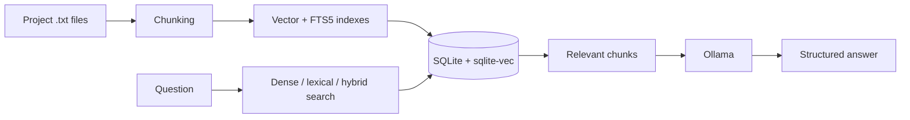

<pre align="center">
__  __     ______     ______     ______
/\ \/\ \   /\  == \   /\  __ \   /\  ___\
 \ \ \_\ \  \ \  __&lt;   \ \  __ \  \ \ \__ \
   \ \_____\  \ \_\ \_\  \ \_\ \_\  \ \_____\
    \/_____/   \/_/ /_/   \/_/\/_/   \/_____/
</pre>

<h1 align="center">University RAG CLI</h1>

<p align="center">
  Local-first RAG for indexing project documents and asking questions through Ollama.
</p>

<p align="center">
  
  
  
  
</p>

`urag` is a Kotlin/JVM command-line application that recursively indexes project `.txt` files, stores vector and FTS5 indexes locally in SQLite, retrieves relevant chunks, and generates structured answers with a local Ollama model.

## Highlights

- Fully local document indexing and question answering
- Dense vector search powered by `sqlite-vec`
- Separate index and query profiles selected by ID
- Configurable embedding model, chunking strategy, dense/lexical/hybrid retrieval, and `topK`
- Structured JSON responses from Ollama
- One-shot shell commands and a full-screen interactive terminal
- Persistent operation cancellation with `Ctrl+C`

## How it works



## Requirements

- JDK 21
- Ollama available at `http://localhost:11434`
- Embedding model `qwen3-embedding:8b`
- Question model `qwen3.5:9b`

Pull the default models:

```shell
ollama pull qwen3-embedding:8b
ollama pull qwen3.5:9b
```

## Modules

Research materials and sample data are grouped under `@data/research/` and `@data/examples/`, separate from the application modules.

| Module | Responsibility |
| --- | --- |
| `app` | Entry point, Koin wiring, application resources, and JAR packaging |
| `backend-parent:cli-impl` | Commands, terminal UI, and launcher |
| `backend-parent:core` | Shared models, operation support, and helpers |
| `backend-parent:storage-impl` | JDBC repositories, Flyway, and sqlite-vec loading |
| `backend-parent:llm-impl` | Ollama HTTP client and embedding preprocessing |
| `backend-parent:index-impl` | File discovery, chunking, indexing, removal, and index profiles |
| `backend-parent:query-impl` | Retrieval, query profiles, answers, and research |
| `backend-parent:judge-impl` | Datasets, judging, metrics, comparisons, and reports |

Application resources live in `app/src/main/resources`. The `app:processResources` task also packages the platform-specific sqlite-vec library.

The root build aggregates the application, CLI, and backend modules. Use qualified tasks such as `:backend-parent:query-impl:compileKotlin` or `:backend-parent:cli-impl:test` to work with one module. Both root `run` and `:app:run` use the project root as the working directory.

## Build

Linux and macOS:

```shell
./gradlew build
```

Windows:

```powershell
.\gradlew.bat build
```

The executable fat JAR is created at `build/libs/urag.jar`.

## Quick start

List the available profiles and index either the whole project or one file:

```shell
java -jar build/libs/urag.jar profiles
java -jar build/libs/urag.jar index --all --config 1
java -jar build/libs/urag.jar index docs/admission.txt --config 1
```

Inspect project files and their indexing status:

```shell
java -jar build/libs/urag.jar files
java -jar build/libs/urag.jar files --config 1 --pending
```

Search without generation, or ask across all ready indexes:

```shell
java -jar build/libs/urag.jar search "What is dependency injection?" --all --profile 1 --explain
java -jar build/libs/urag.jar ask "Summarize this project" --all --profile 1
java -jar build/libs/urag.jar report @data/examples/dataset
```

> [!IMPORTANT]
> `--config` selects an index profile. `--profile` selects a query profile. Both IDs are shown by `profiles`.

## Commands

The `/` prefix is required in interactive mode and optional in one-shot shell mode.

| Command | Description |
| --- | --- |
| `files [--config ID] [--indexed\|--pending\|--failed]` | List project text files and indexing status. |
| `index <file> --config ID` | Index one project text file. |
| `index --all --config ID` | Recursively index all project text files. |
| `unindex (<file> [--config ID]\|--all)` | Remove indexes for a file, or remove all stored indexes and documents. |
| `profiles [index\|query]` | List index and query profiles. |
| `search "query" [--all\|--file PATH\|--index ID] [--profile ID] [--explain]` | Retrieve chunks without answer generation. |
| `ask "question" [--all\|--file PATH\|--index ID] [--profile ID]` | Retrieve context and generate an answer. |
| `research "question" [--explain]` | Research across all ready indexes with up to three searches, cited claims, and unresolved questions. |
| `report <dataset-directory>` | Run all evaluation datasets in a directory and generate one report. |
| `help` | Display the available commands. |
| `exit` | Exit interactive mode. |

Running without arguments, with `-h`, or with `--help` displays command help. Failed one-shot commands return a non-zero exit code.

## Agentic research

```shell
java -jar build/libs/urag.jar research "Who participated in the event and what were its consequences?" --explain
```

Use `/research "question"` in interactive mode. Research always searches all ready indexes with the default query profile. After an initial search, the model can choose a focused follow-up query or finish early. The run stops after at most three searches, a repeated query, or two consecutive searches without new sources. Multi-query expansion is disabled for research.

When ready indexes use different embedding models, research announces a switch to lexical search so it can search all indexes. Stale indexes whose configuration hashes no longer match a resource profile require reindexing.

The answer lists supported claims with source IDs, source files and chunk IDs, unresolved questions, the stopping reason, and total token usage. Source IDs are validated against the evidence supplied to the answer model; this does not independently verify the factual support of a claim. A failed citation validation allows one answer regeneration. `--explain` displays search queries and new-source counts. The terminal status shows progress, and `Ctrl+C` cancels the active operation in interactive mode.

Research logs in `.data/logs/` include search steps, model decisions, the collected sources, the final context source IDs, token usage, and the answer or failure. Questions are limited to 1,000 characters. Each search selects at most eight chunks within a 5,500-character context; the shared model evidence context holds at most twelve sources within 12,000 serialized characters.

## Interactive mode

```shell
java -jar build/libs/urag.jar --interactive
```

Start typing `/` to open command suggestions. Available terminal controls:

| Input | Action |
| --- | --- |
| `↑` / `↓` | Navigate command suggestions, including suggestions outside the visible window. |
| `Enter` | Complete the selected suggestion or execute the current command. |
| `Esc` | Close command suggestions. |
| `Page Up` / `Page Down` | Scroll through chat history. |
| Mouse wheel | Scroll through chat history. |
| `Ctrl+C` | Cancel the active operation; press again when idle to exit. |

Text can be selected normally with the mouse, without holding `Shift`.

## Configurations

Index profiles live in `app/src/main/resources/configurations/indexing`. They select the embedding model and chunking behavior:

```json
{
  "id": 1,
  "name": "Default indexing",
  "description": "Indexes documents with fixed-size chunks and Qwen embeddings.",
  "embeddingModel": "qwen3-embedding:8b",
  "chunkingStrategy": "FIXED_SIZE",
  "parameters": {
    "chunkSize": "1000"
  }
}
```

The built-in recursive profile (`id: 2`) keeps chunks at or below `targetSize`, preferring paragraph, line,
sentence, and word boundaries before falling back to characters. It prepends up to `overlap` characters from the
previous chunk and validates that the result fits within `maxSize`:

```json
{
  "chunkingStrategy": "RECURSIVE",
  "parameters": {
    "targetSize": "900",
    "maxSize": "1000",
    "overlap": "100"
  }
}
```

Query profiles live in `app/src/main/resources/configurations/query`. They select dense, lexical, or hybrid retrieval, control candidate pools, and fill the final context up to a character budget:

```json
{
  "id": 1,
  "name": "Hybrid search",
  "description": "Combines dense and lexical matches using reciprocal rank fusion.",
  "parameters": {
    "retrievalMode": "hybrid",
    "denseCandidateLimit": "20",
    "lexicalCandidateLimit": "20",
    "rrfK": "60",
    "contextCharBudget": "5500",
    "maxChunks": "10"
  }
}
```

`contextCharBudget` counts the rendered chunk text together with its retrieval metadata and separators. Ranked chunks are added in order until the next chunk would exceed the budget. `maxChunks` is a safety limit; the effective Top-K therefore adapts to chunk size.

IDs must be unique within each profile type. Profiles are displayed in ascending ID order, and each type has a `default.json` marked with `*`.

The application stores only the SHA-256 hash of the selected index profile JSON in the database. Changing that file—including formatting—changes its hash and requires reindexing affected documents. Query profiles are selected at request time and are not persisted with an index.

## Evaluation reports

The `report` command accepts a directory containing files named `dataset-<lowercase-bookname>.json`, such as `@data/examples/dataset`. Paths to source books are resolved relative to each dataset file. All datasets must reference the same built-in index and query profile IDs; they do not redefine profile parameters. Each question contains a reference answer and separate graded gold chunks for every selected index profile.

The command builds every selected index profile for every book and evaluates every question for each index/query profile combination. Every run searches only its selected index, then asks the configured question model to judge the generated answer against the reference answer. All datasets are aggregated into one report; an incorrect answer is an evaluation result, not a command failure.

Datasets can set `"answerMode": "RESEARCH"` to run the bounded research workflow before judging. The default is `"ASK"`, preserving existing datasets. Every research search is restricted to the dataset's current book and index profile. The report includes the research trace and evidence recall for the final context; ranking metrics are omitted for the combined research context. All datasets in one report directory must use the same answer mode.

The one-book starter in `@data/examples/dataset-agent/dataset-odyssey-agent.json` runs four Odyssey questions with index/query profile 1:

```shell
java -jar build/libs/urag.jar report @data/examples/dataset-agent
```

Reports are written relative to the project directory:

```text
reports/run-yyyy-MM-dd-HH-mm-ss/
├── report.json
└── compare.json
```

`compare.json` contains aggregate rows for every index/query profile combination, the same comparison split by dataset,
aggregate metrics for each index profile, and the leading index profile IDs for answer, Recall@3/5, MRR, and NDCG@3/5 metrics.
Both reports include the configured character budget and chunk cap together with mean context usage, effective Top-K,
and available candidate counts. Individual question results contain the same context measurements for that run.

Index and question operation logs remain under `.data/logs`; the report stores relative references to them.

The Gradle `jar` and `build` tasks copy example books and datasets next to the packaged JAR:

```text
build/libs/
├── books/
├── dataset/
├── dataset-agent/
└── urag.jar
```

The packaged example can therefore be run from `build/libs`:

```shell
java -jar urag.jar report dataset
java -jar urag.jar report dataset-agent
```

## Runtime data

The current working directory is treated as the project root. Run the JAR from the directory whose documents should be indexed.

```text
.data/
├── university.db
└── logs/
    └── <timestamp>-<command>-<id>.json
```

- `.data/university.db` contains documents, chunks, index records, statuses, vectors, and the FTS5 index.
- `.data/logs/` contains automatic indexing, search, answer-generation, and research diagnostics, including duration and token usage.
- `.data` itself is excluded from recursive indexing.

> [!NOTE]
> The baseline migration describes a fresh database. When its schema changes during development, remove or migrate an existing `.data/university.db` before running indexing again.

## Tech stack

- Kotlin/JVM and Gradle
- Koin dependency injection
- Mordant terminal UI
- Kotlinx Serialization
- Ollama structured outputs
- SQLite, Flyway, and `sqlite-vec`
